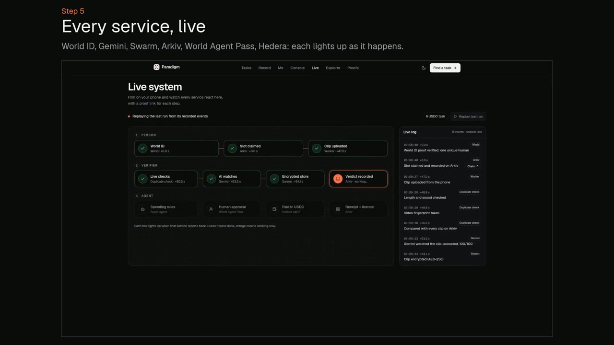

<div align="center">

# Paradigm

**AI agents pay verified humans in USDC to film short clips that teach robots.**

🏆 **Winner, World track (World ID Agent Pass, 1st place), ETHGlobal Mumbai 2026**

[**Live app**](https://paradigmlabs.app) · [**Watch the demo**](https://paradigmlabs.app/demo) · [**Live system map**](https://paradigmlabs.app/live) · [**ETHGlobal showcase**](https://ethglobal.com/showcase/paradigm-2ovdu) · [**Android app**](https://github.com/Abhishek222983101/paradigm-labs/releases/latest)

[](https://paradigmlabs.app/demo)

<sub>3 min 47 s, narrated with captions. Click to watch on paradigmlabs.app/demo, or download it from the <a href="https://github.com/Abhishek222983101/paradigm-labs/releases/latest">latest release</a>.</sub>

</div>

---

## What it is

Robots learn from videos of people doing everyday tasks, and that data is hard to buy fairly. Paradigm is an exchange for it:

1. A robot team's **AI buying agent** posts a paid task, for example *"Fold a T-shirt, filmed from above, 6 USDC"*.
2. A real person **proves they're human with World ID** and films the task on their phone, with a random spoken word and finger count so the clip can't be faked or reused.
3. **Gemini watches the clip, plain code decides.** Accepted clips are encrypted and stored on **Swarm**. The verdict is a public record on **Arkiv**.
4. The agent **pays the person in USDC on Hedera over x402**. Up to 5 USDC it pays on its own. Above that it stops and asks its owner to approve with **World Agent Pass**. Above 10 it never pays.
5. The buyer gets the decryption key only after payment settles. The person gets a **licence on Arkiv owned by their own wallet**.

No Solidity. No wallet pop-ups for contributors. Everything runs on public testnets.

## Try it yourself (about 5 minutes)

You need a phone with **[World App](https://world.org/download)** and a verified World ID. Payments are testnet USDC, so nothing costs real money.

1. **Open the live map in a second tab.** Go to [paradigmlabs.app/live](https://paradigmlabs.app/live) on a laptop and keep it visible. Each service lights up there as it reports back, with a proof link for every step.
2. **Pick a task on your phone.** Open [paradigmlabs.app/tasks](https://paradigmlabs.app/tasks) (or the Android app) and choose *Fold a towel* (3 USDC) or *Fold a T-shirt* (6 USDC).
3. **Prove you're human.** Tap **Claim with World ID** and approve in World App. One person gets one slot per task; Paradigm never learns who you are. On `/live`, *World ID* and *Slot claimed* turn green.
4. **Film it.** The app shows a word and a number of fingers. Say the word, hold up the fingers, do the fold, in one 15–30 s clip. Submit.
5. **Watch the checks.** Your phone and `/live` tick through: upload → length and sound → fingerprint and duplicate check against every clip on Arkiv → Gemini → encrypted to Swarm → verdict on Arkiv. This takes seconds.
6. **Get paid.**
   - **Towel (3 USDC):** under the agent's 5 USDC limit, so it pays on its own over x402 on Hedera.
   - **T-shirt (6 USDC):** above the limit, so the agent pauses. Open [paradigmlabs.app/console](https://paradigmlabs.app/console), find **Approve 6 USDC?**, tap **Open World's approval page → Continue with World ID**, and approve in World App (Orb-verified ID needed). The agent checks World's signed token and then pays.
7. **Check the proofs.** `/live` links the HashScan payment, the Swarm upload and the Arkiv verdict, receipt and licence. Your earnings and licences are on [paradigmlabs.app/me](https://paradigmlabs.app/me).

> In this public demo, any Orb-verified World ID can approve a payment so that visitors can try the flow. In production, the approval is pinned to the agent owner's World ID.

## Pages

| Page | What it shows |
|---|---|
| [`/tasks`](https://paradigmlabs.app/tasks) | Open tasks, read live from Arkiv (only tasks signed by the buyer agent's wallet) |
| [`/live`](https://paradigmlabs.app/live) | Real-time system map: every service as it reports, a live log, proofs, and the last few clips |
| [`/console`](https://paradigmlabs.app/console) | The buyer agent: spending rules, what it did, approvals waiting for a human |
| [`/me`](https://paradigmlabs.app/me) | A contributor's earnings and the licences they own |
| [`/explorer`](https://paradigmlabs.app/explorer) | Every Paradigm record on Arkiv |
| [`/proofs`](https://paradigmlabs.app/proofs) | On-chain proofs with explorer links |
| [`/demo`](https://paradigmlabs.app/demo) | The narrated demo video |

## Architecture

```
Contributor (phone)                      Paradigm                                   Networks
───────────────────                      ────────                                   ────────
1 opens a task  ─────────────────────▶  web (Next.js, Vercel)  ◀── reads tasks ──  Arkiv: adx.task (buyer agent's wallet)
2 World ID check (IDKit) ────────────▶  verify proof server-side; one human per slot ─▶ Arkiv: adx.claim
3 films 15–30 s with a word + finger challenge ─▶ worker (Railway)
                                         probe → fingerprint + dedup ∥ Gemini watches the clip
                                         code decides (AI never decides alone)
                                         AES-256-GCM encrypt ─▶ our Bee node ─────▶ Swarm (ciphertext only)
                                         ─────────────────────────────────────────▶ Arkiv: adx.submission + adx.verification
Buyer agent (Railway)
4 finds accepted clips, GET /api/x402/clip/:key ─▶ 402 (price from the task, payTo = contributor's own Hedera account)
5 policy in code: ≤ 5 USDC pay · > 5 ask a human (World Agent Pass) · > 10 never · 20/day
6 pays over x402 ─▶ facilitator settles USDC on Hedera ─▶ only then: key released, Arkiv receipt + licence
7 every decision ─▶ Hedera Consensus Service spend log
```

| Part | Runs on | What it does |
|---|---|---|
| [`apps/web`](apps/web) | Vercel (Next.js 16) | Task board, World ID claim, phone recorder, live map, earnings, buyer console, explorer, the **x402 endpoint** |
| [`apps/worker`](apps/worker) | Railway (Node 22 + ffmpeg) | Upload, verification pipeline, encryption, Swarm upload, Arkiv writes |
| [`apps/agent`](apps/agent) | Railway | The buying agent: reads price and payee from the 402, applies the policy, pays, opens World Agent Pass approvals, writes the HCS spend log |
| [`infra/bee`](infra/bee) | Railway (private network) | Our own Bee 2.8.3 Swarm node with our own postage batch |
| [`packages/shared`](packages/shared) | | Arkiv schemas and write guard, spending policy, verdict rules, crypto, Hedera and Swarm helpers |
| [`packages/db`](packages/db) | Neon Postgres | Private state only: jobs, events, payments, approvals, nullifiers |

More: [`docs/sponsors/ARCHITECTURE.md`](docs/sponsors/ARCHITECTURE.md) · [`docs/sponsors/PRODUCT.md`](docs/sponsors/PRODUCT.md) · [`docs/build/SYSTEM-ARCHITECTURE.md`](docs/build/SYSTEM-ARCHITECTURE.md)

## Partner technology

### World: World ID + World Agent Pass (track winner)

| What | How | Code |
|---|---|---|
| **World ID (IDKit 4)** | Claiming a task needs a World ID proof. The proof's signal is bound to the task and the contributor's wallet, so it can't be replayed. It's verified server-side, and the nullifier gives one slot per person per task. Nullifiers stay private in Postgres, never on Arkiv. | [`apps/web/src/lib/server/world.ts`](apps/web/src/lib/server/world.ts) |
| **World Agent Pass (World IdP)** | Above 5 USDC the agent starts an OIDC device login at `auth.world.org`, asking for Orb-level verification. We verify the signed id_token ourselves: issuer, audience, RS256 signature via JWKS, `acr` = Orb, fresh `auth_time`. Each approval covers one exact clip, amount and payee. | [`apps/agent/src/approval.ts`](apps/agent/src/approval.ts) |

Proofs: 6 USDC paid after a human approval with World ID, [tx 1](https://hashscan.io/testnet/transaction/0.0.9185802@1794003438.891569019) and [tx 2](https://hashscan.io/testnet/transaction/0.0.9185802@1794004233.343699894). Notes and feedback for World: [`docs/sponsors/WORLD-DEBRIEF.md`](docs/sponsors/WORLD-DEBRIEF.md).

### Hedera: x402 payments, no Solidity

| What | How | Code |
|---|---|---|
| **x402 payments** | Clips are sold behind `GET /api/x402/clip/:key`. Unaccepted clips return 404; accepted ones return 402 with the task's price and `payTo` = the contributor's own Hedera account. The facilitator settles testnet USDC (`0.0.429274`). The key, receipt and licence are released only after settlement. | [`apps/web/src/app/api/x402/clip/[key]/route.ts`](apps/web/src/app/api/x402/clip/%5Bkey%5D/route.ts) · [`apps/agent/src/pay.ts`](apps/agent/src/pay.ts) |
| **Spending policy** | Plain code, not an LLM: ≤ 5 USDC pay, > 5 ask a human, > 10 never, 20 per day. | [`packages/shared/src/policy.ts`](packages/shared/src/policy.ts) |
| **Contributor accounts** | Hedera accounts created from the phone wallet's key (ECDSA alias, unlimited auto-association), so contributors never sign anything or associate tokens. | [`scripts/hedera-alias-spike.ts`](scripts/hedera-alias-spike.ts) |
| **Consensus Service spend log** | Every decision (paid, paused, approved, declined) is a message on HCS topic [`0.0.11343565`](https://hashscan.io/testnet/topic/0.0.11343565). | [`apps/agent/src/log.ts`](apps/agent/src/log.ts) |
| **Hedera Agent Kit 4.2** | Only two tools loaded: `submit_topic_message` and `get_account_token_balances`, so the kit can't move money. | [`apps/agent/src/hedera-kit.ts`](apps/agent/src/hedera-kit.ts) |

Settled payments (Hedera testnet):

| When (IST) | Amount | Approved by | Transaction |
|---|---|---|---|
| 06 Nov 08:25 | 0.01 USDC | agent (first x402 smoke test) | [0.0.9185802@1793933035.147018991](https://hashscan.io/testnet/transaction/0.0.9185802@1793933035.147018991) |
| 06 Nov 23:45 | 0.05 USDC | agent | [0.0.9185802@1793988295.049547956](https://hashscan.io/testnet/transaction/0.0.9185802@1793988295.049547956) |
| 07 Nov 00:25 | 3 USDC | agent, first real phone clip | [0.0.9185802@1793991330.634664318](https://hashscan.io/testnet/transaction/0.0.9185802@1793991330.634664318) |
| 07 Nov 02:13 | 3 USDC | agent | [0.0.9185802@1793997829.041959715](https://hashscan.io/testnet/transaction/0.0.9185802@1793997829.041959715) |
| 07 Nov 03:47 | **6 USDC** | **human, World Agent Pass (Orb)** | [0.0.9185802@1794003438.891569019](https://hashscan.io/testnet/transaction/0.0.9185802@1794003438.891569019) |
| 07 Nov 04:00 | **6 USDC** | **human, World Agent Pass (Orb)** | [0.0.9185802@1794004233.343699894](https://hashscan.io/testnet/transaction/0.0.9185802@1794004233.343699894) |

Feedback for Hedera: [`docs/sponsors/HEDERA-FEEDBACK.md`](docs/sponsors/HEDERA-FEEDBACK.md).

### Arkiv: the public record

Tasks, claims, submissions, verdicts, receipts and licences are Arkiv entities, each written by its own role wallet. Trust a record only if its `$owner` is one of these:

| Role | Address | Writes |
|---|---|---|
| Buyer agent | [`0x0F00…Dcc6`](https://rabdi.explorer.arkiv.network/address/0x0F00CFF8dae364c5d7c0840A2C92DFc7d087Dcc6) | `adx.task` |
| Platform | [`0x2dEc…D98C`](https://rabdi.explorer.arkiv.network/address/0x2dEc12a23ec38830f7f314B33b144D4d1fe4D98C) | `adx.claim`, `adx.licence` (then transferred to the contributor) |
| Worker | [`0xCDFa…2A51`](https://rabdi.explorer.arkiv.network/address/0xCDFa94802dEEAaf2ce7E694F2d16BE2628d52A51) | `adx.submission` (Swarm ref, sha256, fingerprints) |
| Verifier | [`0x0C73…F421`](https://rabdi.explorer.arkiv.network/address/0x0C736210492F8d86A1Fe4297cD7A5804ed48F421) | `adx.verification`, `adx.receipt`, `adx.verifier` |

Fingerprints on Arkiv let the worker catch a clip that's already been sold. Every write goes through one guard ([`packages/shared/src/arkiv/guard.ts`](packages/shared/src/arkiv/guard.ts)) that refuses anything secret-looking: no nullifiers, keys, raw video or personal data ever reach Arkiv.

Query the open tasks yourself (public RPC, no key):

```bash
curl -s https://rpc.rabdi.db-chain.testnet.arkiv.network -H 'content-type: application/json' -d '{
  "jsonrpc":"2.0","id":1,"method":"arkiv_query",
  "params":["arkiv.schema = str('\''adx.task'\'') AND status = str('\''open'\'') AND $owner = addr(0x0F00CFF8dae364c5d7c0840A2C92DFc7d087Dcc6)",
            {"select":{"key":true,"owner":true,"expiresAt":true,"attributes":{"title":true,"reward":true,"slots":true}},"limit":"0x32"}]}'
```

Arkiv docs in this repo: [`schema`](arkiv/schema.md) · [`why Arkiv`](arkiv/why-arkiv.md) · [`how we use it`](arkiv/how-you-use-arkiv.md) · [`friction log`](arkiv/friction.md) · [`reach`](arkiv/reach.md)

### Swarm: encrypted clip storage

Clips are encrypted with AES-256-GCM before they leave the worker, then stored through **our own Bee 2.8.3 node** with **our own postage batch**, bought on-chain with sBZZ we swapped from Sepolia ETH. Swarm holds only ciphertext. The buyer gets the key only after the Hedera payment settles. Details: [`arkiv/swarm.md`](arkiv/swarm.md) · [`infra/bee`](infra/bee) · [`docs/sponsors/SWARM-FEEDBACK.md`](docs/sponsors/SWARM-FEEDBACK.md).

### Gemini: the verifier

Gemini 3 Flash watches each clip **without being told the expected answer**. It reports what it sees: which steps happened, the spoken word, the finger count, signs of a screen or replay. **Plain code** ([`packages/shared/src/verdict.ts`](packages/shared/src/verdict.ts)) compares that report with the task's rubric and the challenge, then accepts, sends to review, or rejects.

**Every on-chain action, with a link:** [`docs/sponsors/PROOFS.md`](docs/sponsors/PROOFS.md).

## Run it locally

Requirements: Node 22+, pnpm 10, ffmpeg (worker), and the accounts listed in [`.env.example`](.env.example).

```bash
pnpm install
cp .env.example .env          # fill in your own values; never commit .env
pnpm doctor                   # live check of every key and service
pnpm db:push                  # create the private Postgres tables
pnpm seed:arkiv               # verifier listing + a demo task on Arkiv
pnpm dev                      # web on :3000
pnpm worker:dev               # worker on :8099
pnpm --filter @adx/agent dev  # the buying agent
pnpm outside-agent            # what any outside agent sees, from Arkiv only
```

`pnpm verify` runs typecheck, lint, unit tests and the build. Integration tests use real testnets in a separate `adx-test` namespace: `pnpm test:claims`, `test:upload`, `test:pipeline`, `test:x402`, `test:agent`.

## Built with

- **World:** `@worldcoin/idkit` 4.6, `@worldcoin/idkit-server` 1.2, World IdP (OIDC device flow), `jose`
- **Hedera:** `@x402/next`, `@x402/fetch`, `@x402/hedera` 2.30, `@hiero-ledger/sdk` 2.90, `@hashgraph/hedera-agent-kit` 4.2
- **Arkiv:** `@arkiv-network/sdk` 1.0.1 (Rabdi testnet)
- **Swarm:** Bee 2.8.3, HTTP API
- **AI:** `@google/genai` (Gemini 3 Flash), Claude Haiku (one-line notes in the spend log)
- **App:** Next.js 16, Tailwind 4, shadcn/ui, Hono, Drizzle + Neon, viem, zod, Biome, Vitest. Android app: a Trusted Web Activity of paradigmlabs.app.

## Honest scope

- Testnets only: Hedera testnet, Arkiv Rabdi, Swarm on Sepolia.
- Licence withdrawal (a contributor removes their clip from sale) is designed in [`arkiv/schema.md`](arkiv/schema.md) but not built.
- Selfie Check needs World to enable it for our app. Claims accept any verified World ID; payment approvals require Orb.
- Gemini's report never decides on its own; the rules in code do.

## History

This repo continues **Paradigm** as built at ETHGlobal Mumbai 2026 (5–7 Nov). The version that was submitted and judged, with its full commit history, is frozen at [Abhishek222983101/agentic-data-exchange](https://github.com/Abhishek222983101/agentic-data-exchange). AI assistance is disclosed in [`AI_USAGE.md`](AI_USAGE.md).

Licence: [MIT](LICENSE).
