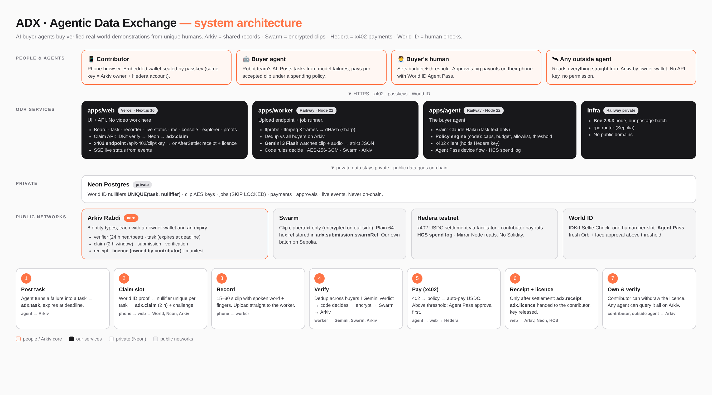

# Paradigm — The overview (read this first)

*Paradigm is the product and team name; "ADX" (Agentic Data Exchange) is the internal code name you'll see in code and docs.*

Plain-language guide to what we're building, how the pieces fit, and what each build phase does. The engineering detail is in `SYSTEM-ARCHITECTURE.md`. This file is for humans: you, teammates, a manager, a judge.

## The idea in 30 seconds
Robots fail at everyday tasks like folding a towel. The teams behind them need videos of real people doing exactly those tasks, from many *different* people, with proof of who filmed what and permission to use it.

ADX is a marketplace where **an AI agent is the buyer**. It posts paid tasks for the things its robot fails at. Verified humans film short clips on their phones. An AI checks each clip. The agent pays each person in USDC. Every record is public and checkable, and each person owns the licence for their own clip.

## The five pieces (and what each sponsor does)
| Piece | Plain meaning | Sponsor |
|---|---|---|
| **Shared records** | A public database where tasks, claims, verdicts, receipts and licences live. Anyone can read it; each record says which wallet wrote it and when it expires | **Arkiv** |
| **File storage** | Where the video clips live, scrambled (encrypted) so only a paying buyer can open them | **Swarm** |
| **Payments** | The agent pays per clip over "x402", a way for software to pay inside a normal web request. Settles in USDC in seconds | **Hedera** |
| **Human checks** | Proves each contributor is a unique real person (one slot each), and lets the buyer's human approve big payments with a fresh face check | **World ID** |
| **The brain** | AI that checks clips (Gemini watches the video with sound) and writes the agent's tasks (Claude) | Google, Anthropic |

## One task, start to finish
1. **The agent posts a task.** "Fold a towel, filmed from above. 3 people needed. 3 USDC each. Open for 24 hours." It becomes a public record on Arkiv that disappears by itself when the 24 hours are up.
2. **A person claims a slot.** They open the app on their phone, tap Claim, and prove they're a unique human with World ID. Try again with the same person and it says no.
3. **They film it.** The app gives a random challenge ("say MANGO, show 3 fingers") so nobody can upload an old video. They record 15–30 seconds.
4. **The clip gets checked.** In about 20 seconds: has this clip been sold before, anywhere? Does the AI see every fold step, with timestamps? Did they say the word? The clip is then scrambled and stored on Swarm.
5. **The agent pays.** It finds the clip, sees the price, checks its own rules (budget, limits) and pays in USDC on Hedera, with no human involved. Big payments pause until the buyer's human approves on their phone.
6. **The person owns the licence.** A licence record is created and handed to their wallet. If they withdraw it, every buyer's agent sees that and stops using the clip.
7. **Anyone can check it all.** A separate script on another laptop reads the same records straight from Arkiv, no permission needed.

## Why this is hard to copy
- **The buyer is a real agent with enforced rules.** The AI can suggest, but plain code decides what it may spend. A clever prompt can't make it overspend.
- **The payment actually happens.** Skarl, the closest prior project, never paid a real contributor. We have a real settled payment already.
- **Records are open.** Other companies keep this in private databases. Ours lives on Arkiv, so any agent can read it and trust it by who signed it.
- **Contributors own their licence.** Ownership and expiry on Arkiv make consent checkable and withdrawable, right as India's DPDP consent rules start (13 Nov 2026).

## The build phases in plain words
Difficulty is out of 5. We build in this order because each phase needs the one before. The hardest phases are 6, 5 and 2 (then 4), so we reach them as early as the order allows.

| Phase | What it is | Difficulty | What you'll see when it's done |
|---|---|---|---|
| **0 Foundation** | Set up the codebase, database tables, design colours, the empty app | 2 | The empty app shell, light and dark, on the live URL |
| **1 Arkiv core** | Define the 8 record types, a safety check that blocks secrets from going public, the first reads | 3 | A real task on the board, read live from Arkiv, plus an "explorer" page showing the raw records |
| **2 Identity** | A wallet that lives in the phone (no app install), and World ID to claim a slot | 4 | Claim a task; a second try by the same person is refused |
| **3 Capture** | The camera screen with the challenge, and uploading the clip | 3 | Record a clip with a progress bar |
| **4 Verification** | The checking machine: duplicate check, AI verdict, encryption, Swarm storage, Arkiv records | 4 | The clip's checks ticking off live on the phone, then a verdict with timestamps |
| **5 Payments** | The paid endpoint and what happens after money arrives (receipt, licence) | **5** | A real payment on HashScan and a receipt on Arkiv |
| **6 Agent** | The buyer agent: posts tasks, decides payments by its rules, asks a human above the limit, logs every decision publicly | **5** | The agent paying on its own; a big payment waiting for phone approval; a declined one paying nothing |
| **7 Licences** | My licences, withdraw, and the outside-agent check | 3 | Withdraw a licence and watch the agent drop the clip |
| **8 Console + polish** | The buyer's dashboard, the landing page, final design | 3 | A clean, fast app anyone can use without help |
| **9 Testing** | Measure accuracy on 16 test clips, security review, reset drill | 3 | Real accuracy numbers |
| **10 Submission** | Sponsor docs, README, demo video | 2 | Submitted before Saturday 09:00 |

## The parts of the code that matter most
- **The policy engine** (`apps/agent/src/policy.ts`): the rules that decide whether the agent may pay. It's the heart of the Hedera "spending controls" score and the reason a hijacked prompt can't drain the wallet.
- **The write guard** (`packages/shared/src/arkiv/guard.ts`): everything on Arkiv is public, so this blocks anything that looks like a secret before it's written.
- **The payment hook** (`onAfterSettle` in the paid endpoint): receipts, licences and the unlock key are only produced *after* the money has really moved.
- **The verification pipeline** (`apps/worker/src/pipeline/`): fingerprints the clip to catch re-uploads, asks Gemini for a step-by-step verdict, lets plain code decide, and stores the encrypted clip.
- **The Arkiv schemas** (`packages/shared/src/arkiv/schemas.ts`): the 8 record types everything else reads and writes.

## How the AI checking works
We don't train a model. One strong AI looks at each clip, and plain code makes the final call:
1. **Fingerprint (catch re-uploads):** ffmpeg grabs 3 frames (0.3 s). A small TypeScript step turns each into a "perceptual hash", a fingerprint that stays almost the same even if a video is re-compressed. We compare them with every clip on Arkiv, including clips sold to other buyers.
2. **Watch and listen:** Gemini 3 Flash watches the whole clip *with sound* in one call. It reports, in a fixed format, whether it heard the challenge word, how many fingers it saw, and which fold steps happened at which second, each with a one-line reason.
3. **No guessing allowed:** for every step Gemini can answer "not visible", so it never has to invent anything. Its timestamps are checked by code: they must be inside the clip and in order.
4. **Code decides:** wrong word, wrong finger count, or a missing step → reject. Anything unclear → human review. Clean and confident → accept. The AI never gets the final say.
5. **Measure:** we run 16 clips we recorded ourselves and publish the real error rates.

Why Gemini and not Claude here: Claude's API can't take video or audio, so it would only see a few still frames and a separate transcript. Gemini sees and hears the whole clip. Claude is still used by the buyer agent to write tasks.

## Where things live
- **Live app:** https://adx-paradigm.vercel.app
- **Code:** https://github.com/Abhishek222983101/agentic-data-exchange
- **Proof of everything on-chain:** `docs/sponsors/PROOFS.md`
- **What broke with each sponsor's tools:** `docs/sponsors/session-logs/`
- **Full engineering plan:** `docs/build/SYSTEM-ARCHITECTURE.md`

## Words you'll hear
- **Entity (Arkiv):** one record, owned by a wallet, with an expiry date.
- **x402:** pay-per-request for software; the server answers "402 Payment Required" with a price, the agent pays and retries.
- **Facilitator:** the service that settles the x402 payment on Hedera and pays the network fee.
- **Nullifier (World ID):** an anonymous number that's the same every time one person does one action, so we can say "already claimed" without knowing who they are.
- **Postage batch (Swarm):** prepaid storage. Every upload is stamped with it.
- **HCS:** Hedera's public message log; we post every spending decision there so it can't be quietly changed.
- **Embedded wallet:** a wallet created inside the app and locked with the phone's passkey, so contributors don't need to install anything.
