# ADX — System Architecture and Build Plan

> **Agentic Data Exchange** · ETHGlobal Mumbai 2026 · Team Paradigm
> Written 6 Nov 2026 (Fri) ~11:30 IST. Submissions close **Sat 7 Nov 09:00 IST**.
> This is the single reference for building ADX. The coding agent builds phase by phase from §19. Humans read `docs/build/OVERVIEW.md` first.

## The whole system at a glance

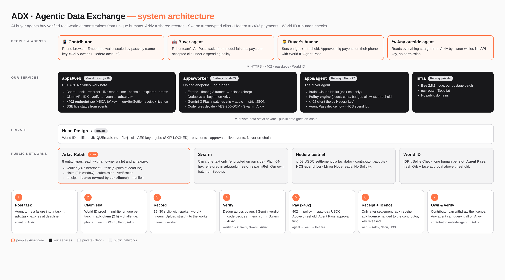

*Source: `diagrams/architecture.html` (open in a browser). Every Mermaid diagram below also has a rendered image in `diagrams/`.*

## Contents
0. How to use this document
1. Ground truth: what already exists (verified)
2. Requirements, word for word, and the traceability matrix
3. The product on one page
4. Decisions locked
5. Architecture principles
6. The stack: which language does what, and why
7. Repository layout
8. System diagrams
9. Modules in depth (frontend, backend, worker, agent, shared, infra)
10. Data model: Arkiv, Neon, Swarm, Hedera
11. The verification pipeline (the "ML" part)
12. Payments and the spending policy
13. Identity: embedded wallet, World IDKit, World Agent Pass
14. UX and design system
15. Security and threat model
16. Performance budget and metrics
17. Observability and testing
18. Configuration: environment variables per service
19. **Build plan: phases, sub-phases, acceptance**
20. Sponsor deliverables and submission checklist
21. Risks and fallbacks
22. References (links and local paths)

---

## 0. How to use this document

**For the coding agent (Sonnet 5):**
1. Read §1–§5 once. Read the module section (§9–§13) for the phase you're on.
2. Work through §19 in order. Every sub-phase has: goal, files, steps, code sketch, acceptance, and "what you'll see".
3. A sub-phase is done only when its acceptance checks pass **when actually run**. Update `docs/build/BUILD-PLAN.md` (checklist) and `docs/sponsors/PROOFS.md` (any on-chain action) in the same commit.
4. Commit at the end of every sub-phase (feature-sized message, Co-Authored-By line). Push. Never commit `.env`.
5. When something breaks in a sponsor's tool (not our own mistake), add a row to `docs/sponsors/session-logs/<sponsor>-session.md` with repro steps.
6. Before touching an SDK, check its installed version's README/types in `node_modules`. Don't trust memory for Arkiv (SDK 1.0), x402 (v2), IDKit (4.x) or World IdP.
7. Never write secrets into code, docs, Arkiv entities or logs. Every Arkiv write goes through `packages/shared/src/arkiv/guard.ts`.

**For humans:** `OVERVIEW.md` explains the concept of every phase in plain language. This file is the engineering detail.

**Status legend:** ✅ done and verified · 🟡 in progress · ⬜ not started · 🧪 needs a spike (unverified assumption, test it first).

---

## 1. Ground truth: what already exists (verified 6 Nov)

| Item | State | Proof |
|---|---|---|
| Repo | Public, MIT, pnpm workspace, noreply git identity | github.com/Abhishek222983101/agentic-data-exchange |
| Web app | Next.js 16.4.5 scaffold deployed | https://adx-paradigm.vercel.app (Vercel project `agentic-data-exchange`) |
| Arkiv | Access key, tGLM, Claude plugin 0.5.4, first write + query | PROOFS ARK-01 |
| Hedera | Operator + buyer/merchant/2 contributor accounts, USDC associated, buyer funded 20 USDC | PROOFS HED-01 |
| Hedera x402 | First settled payment, agent paid with no human | PROOFS HED-02 · `0.0.9185802@1793933035.147018991` |
| Swarm | Our Bee 2.8.3 light node on Railway (Sepolia), chequebook deployed, our own postage batch (depth 20, ~2.9 days) | PROOFS SWM-03/04 · batch `c0cc5436…2665` |
| RPC router | Railway service routing Bee's Sepolia RPC calls | `infra/rpc-router` |
| World IDKit | App `app_b3f89d34c3b6056074a99f171452368e`, RP `rp_15b590932690a33e`, action `claim-task` | PROOFS WLD-01 |
| World Agent Pass | IdP client `50595151-fdb6-4971-b9e3-00cdb7dfe976`, redirect `https://adx-paradigm.vercel.app/api/auth/world/callback`, default Selfie Check + Face Auth | PROOFS WLD-02 |
| AI keys | Claude (Haiku 5.5 tested), Gemini (3 Flash listed), Groq ×2 | `.env` |
| Neon | Postgres 18 (Singapore) + S3-compatible object storage | `.env` |
| Railway | Project `adx` (services `bee`, `rpc-router`) | `railway status` |
| Scripts | `arkiv:smoke`, `hedera:setup`, `x402:smoke`, `swarm:smoke`, `swarm:fund`, `swarm:fund-node`, `swarm:buy-batch` | `package.json` |

---

## 2. Requirements, word for word, and the traceability matrix

These are copied from the official ETHGlobal pages (6 Nov 2026). Every requirement gets an ID. The matrix in §2.7 maps each ID to the phase that satisfies it and the acceptance test that proves it. **No ID may be left unmapped.**

### 2.1 ETHGlobal rules (ethglobal.com/events/mumbai/info/details)
- **E-1** "Start Fresh (Classic Track): If you're entering the Classic "From Scratch" track, all work on your project must begin after the hackathon officially starts. Any prior project-specific code, designs, or assets are not allowed unless they're from public libraries or starter kits."
- **E-2** "Version Control: Use version control to track your code during the event. Submissions with large single commits or missing histories may be disqualified."
- **E-3** "Partner Prizes: On the last step of the submission form, you can select up to 3 Partner Prizes to apply for. If a partner has multiple tracks, you can be eligible for all of them while only counting as 1 Partner Prize."
- **E-4** "Involvement: AI tools should be used to assist your development process, not to create the entire project."
- **E-5** "Spec-Driven Development: … If you use one, you must include all spec files, prompts, and planning artifacts in your submission repository."
- **E-6** Demo video 2–4 minutes, at least 720p, no speed-up, no phone recording of the screen, no AI voiceover. Finalists: 4 min demo + 3 min Q&A. Submissions close Sat 7 Nov 09:00 IST, no late entries.

### 2.2 Hedera — 🤖 AI Agents That Pay: x402 on Hedera ($6,500)
Qualification:
- **H-1** "At least one x402-protected endpoint that settles on Hedera testnet or mainnet through any facilitator listed in the Hedera docs (Official x402, Ax402, or Blocky402), or through a facilitator you run yourself."
- **H-2** "An agent or client that finds the endpoint and completes at least one paid request end to end, with no human approving."
- **H-3** "A public GitHub repo with a README that covers setup, architecture, and the payment flow, including the Hedera transaction ID of at least one settled payment."
- **H-4** "A demo video of 5 minutes or less that shows a payment settling and links to it on HashScan."

Extra points:
- **H-5** "Spending controls for agents: budgets, per-merchant limits, allowlists, or a human-in-the-loop approval above a set amount."
- **H-6** "Agent identity and reputation through HCS-14 or ERC-8004"
- **H-7** "An HCS topic used as a tamper-evident audit log of each agent's spending."
- **H-8** "Multi-agent negotiation (A2A or ACP) before the payment is made."
- **H-9** "Settling in an HTS token such as USDC, or using HTS custom fees to split revenue."
- **H-10** "Recurring or subscription-style payments through Scheduled Transactions."
- **H-11** "Use of the Hedera Agent Kit or Hedera Network MCP."

Also tick 🚫 **"No Solidity Allowed": Build with Hedera SDKs** ($2,000), same partner pick:
- **HN-1** "Use the Hedera JavaScript/TypeScript SDK or Python SDK, with no Solidity smart contracts."
- **HN-2** "Use at least two native Hedera services (for example, HTS and HCS)."
- **HN-3** "A public GitHub repo with a README covering setup and usage." **HN-4** "A demo video of 5 minutes or less."
- Extra: "A coherent end-to-end user experience." "Integration with the Hedera Mirror Node REST API." "Creative use of HCS for data integrity, logging, or messaging." "The Hedera Agent Kit for AI-driven workflows." "A thoughtful security approach (key management, access controls)."

### 2.3 Arkiv — 🧩 Build on Arkiv (from scratch) ($4,000) + 🐝 Arkiv + Swarm bonus ($500)
Build on Arkiv — "Build a new app whose data lives in Arkiv. You query its entities with SQL-like filters, and each one has an owner wallet and an expiration you choose." Directions include "Agents: ephemeral coordination state: tasks, bids and claims that agents share, query and let expire." and "Markets: listings or offers that expire at their deadline."

How they judge (25% each):
- **AJ-1** Arkiv feedback, `/arkiv/friction.md`: "What should we improve today to make Arkiv better…? When something broke, what did you expect, what happened, and how can we reproduce it?"
- **AJ-2** Reach, `/arkiv/reach.md`: "Who is it for, and would they use it? Can they try it today, and will you keep building it after Mumbai?"
- **AJ-3** Why Arkiv, `/arkiv/why-arkiv.md`: "If you swapped Arkiv for Postgres or any other database, what would your users lose? What did you keep off Arkiv, and why?"
- **AJ-4** How you use Arkiv, `/arkiv/how-you-use-arkiv.md`: "Do the things you filter on, who can edit each entity, and when it expires fit what your app does? Does each Arkiv feature you use change something your users see?"

Qualification:
- **A-1** "Built from scratch at ETHGlobal Mumbai, following ETHGlobal's rules."
- **A-2** "Your app writes to Arkiv's current testnet … with @arkiv-network/sdk or the JSON-RPC API, and at least one feature users see reads its data from Arkiv."
- **A-3** "In your README: the wallet address(es) that wrote your entities, and one query we can run."
- **A-4** "/arkiv/schema.md: your entities, the fields you query, who owns them and when they expire. /arkiv/friction.md: your feedback."
- **A-5** "One file per criterion in How we judge, at the path next to it, answering its questions with links, numbers or a query we can run."
- **A-6** "A public repo with an open-source license. Say how you used AI, as ETHGlobal's rules require."
- **A-7** "Not counted: the SDK installed but never used to read, or Arkiv used only as a log that nothing reads."

Swarm bonus:
- **S-1** "Your project uses both Arkiv and Swarm."
- **S-2** "/arkiv/swarm.md in your repo, with: What you keep on Swarm, what you keep on Arkiv, and which entity field holds the Swarm reference or feed. One Arkiv entity key and the Swarm reference it points to, with a link we can open. The postage stamp batch ID you uploaded with and the wallet that bought it (or who gave you the batch), and the Bee node or service you uploaded through. The files in your repo that upload to Swarm and read from it. Steps to run one upload and one read yourself, what they need, and what we should see. The moment in your demo video where Swarm is used. What got in your way with Swarm."
- **S-3** "Careful: an encrypted Swarm reference contains its key, and Arkiv entities are public. Never store one in an entity as it is: encrypt it first or keep it off Arkiv."

### 2.4 World — 🚀 World ID Agent Pass ($5,000) + 🪪 Best Use of IDKit ($2,500)
Agent Pass: "Show what becomes possible when an application can ask a person to authenticate or complete a fresh verification at the moment. Strong submissions will show a meaningful action that needs a human identity or approval layer, not simply a login screen added to an existing product." "NOTE: Proofs are using fake identities, DO NOT rely in them for production."
- **W-1** "Integrate with the official World ID Agent Pass."
- **W-2** "Demonstrate the complete journey: identity or verification request, user completion, validated result, and the protected application or agent action."
- **W-3** "Demonstrate a denied, expired, cancelled, or otherwise unsuccessful path where the protected action does not occur."
- **W-4** "Validate identity results in a secure backend; do not expose client secrets or treat an unvalidated client response as authorization."
- **W-5** "Include a short integration debrief/feedback: time to first success, friction encountered, missing capability or documentation, and the one improvement with the greatest impact."

IDKit: "Build a product that uses IDKit to solve a real trust moment… We are rewarding the best decision about which credential is needed, why it is needed, and how it improves a real product experience."
- **WI-1** "Integrate IDKit in a functioning application, mini app, or onchain flow."
- **WI-2** "Use at least one supported World ID credential and verify the result on the server or onchain as appropriate."
- **WI-3** "Clearly explain the specific product event requiring trust and why the chosen credential is the minimum sufficient assurance."
- **WI-4** "Demonstrate a successful verification and one meaningful alternative path, such as cancellation, unavailable credential, rejection, or an ineligible user."
- **WI-5** "Include a short integration debrief/feedback…"

### 2.5 Our own brief (team PDF, 1 Nov) — the demands that still stand
- **B-1** One vertical slice: 1 buyer → 1 task → 1 contributor → 1 recording → 1 AI report → 1 approved payment → 1 independently queryable Arkiv record.
- **B-2** "An independent agent discovers a task on Arkiv, pays an x402-protected endpoint, gets evidence-linked output, and accepted work settles under a clear policy."
- **B-3** AI verifier with timestamped evidence, confidence, and a human-review path.
- **B-4** Media stays private; only a hash and a controlled reference are shared.
- **B-5** Honesty: never show a mock payment as real; label simulated payouts; don't call phone video "robotics-grade".

### 2.6 What the requirements really demand (the gist)
1. **Arkiv must be the product's real data layer**, not a log. Users must *see* Arkiv data, and every Arkiv feature we use (filters, ownership, expiry) must change something users see. Ownership and expiry are the core mechanic.
2. **The x402 payment must be autonomous and real**, with a HashScan link in README and video, and spending controls are the highest-value extra.
3. **World must protect a meaningful action** with a failure path where the action doesn't happen, validated server-side.
4. **Swarm must be meaningful** (user-visible files) with our own batch and an encrypted-reference-safe design.
5. **Documentation is a quarter of Arkiv's score** and a required part of World's: friction, reach, why, how, debriefs, with links, numbers and runnable queries.
6. **Everything after Thu 21:00**, steady commits, planning files in the repo, AI usage disclosed.

### 2.7 Traceability matrix
| Req | Satisfied by | Phase | Test |
|---|---|---|---|
| E-1 | Fresh repo, all code after start, planning disclosed | all | `git log` first commit 06 Nov |
| E-2 | Commit per sub-phase | all | — |
| E-3 | Hedera + Arkiv(+Swarm) + World | P10 | submission form |
| E-4/E-5 | `AI_USAGE.md`, `docs/planning/`, this doc | P10 | — |
| E-6 | Demo script, 1080p screen recording, human VO | P10 | video |
| H-1 | `GET /api/x402/clip/:key` (`@x402/next`, `ExactHederaScheme`, x402.org facilitator) | P5 | T-PAY-1 |
| H-2 | Buyer agent discovers endpoint via `adx.verifier` on Arkiv, pays without approval under threshold | P6 | T-AGT-1 |
| H-3 | README payment section + tx IDs | P10 | — |
| H-4 | Video 1:55–2:25 with HashScan | P10 | — |
| H-5 | Policy engine: per-clip cap, daily budget, allowlist, Agent Pass approval above threshold | P6 | T-AGT-2/3 |
| H-6 | (stretch) HCS-14 agent profile topic | P9 | — |
| H-7 | HCS spend-log topic, every decision | P6 | T-AGT-4 |
| H-9 | USDC `0.0.429274` | P5 | T-PAY-1 |
| H-11 | Hedera Agent Kit tools for HCS + transfers inside the agent | P6 | — |
| HN-1/2 | TS SDK only, HTS + HCS (+ Mirror Node REST) | P5/P6 | — |
| AJ-1..4, A-4, A-5 | `/arkiv/*.md` with queries and links | P10 | — |
| A-2, A-7 | Task board, explorer page, agent, outside agent all **read** Arkiv | P1/P7 | T-ARK-2 |
| A-3 | README writer wallets + `curl` query | P10 | — |
| A-6 | MIT + AI_USAGE | ✅ | — |
| S-1..3 | Ciphertext on our Bee node, plain ref in `adx.submission.swarmRef`, key in Neon | P4 | T-SWM-1 |
| W-1..4 | Agent Pass device flow for spend approval, denied/expired paths, server-side id_token validation | P6 | T-WLD-2/3 |
| WI-1..4 | IDKit Selfie Check claim, server verify, duplicate-claim + cancel paths | P2 | T-WLD-1 |
| W-5/WI-5 | `docs/sponsors/WORLD-DEBRIEF.md` from the session log | P10 | — |
| B-1/B-2 | Full slice + outside agent | P7 | T-E2E-1 |
| B-3 | Verdict with timestamped evidence, `review` path | P4 | T-VER-2 |
| B-4 | Encrypted on our side; key released only after payment | P4/P5 | T-SWM-1, T-PAY-2 |
| B-5 | `mode: live|simulated` on every receipt | P5 | — |

---

## 3. The product on one page

**Pitch:** *Your robot's agent buys exactly the demonstrations its model fails on, one per verified human, and pays each person directly on Hedera. Every clip's licence lives on Arkiv, owned by the person who filmed it.*

**The loop:** buyer agent posts a task from a failure case → verified human claims a slot → records a 15–30 s clip with a liveness challenge → worker checks duplicates across all buyers and gets an AI verdict with timestamps → clip stored encrypted on Swarm → agent finds the paid endpoint and pays over x402 (auto under its limit, human approval with World Agent Pass above it) → licence entity created and handed to the contributor → contributor can withdraw it, and every buyer agent sees it.

**Why it beats the prior art:** see `docs/sponsors/PRODUCT.md` (comparison with Skarl, WorldMod, Vangrid). In one line: agent-as-buyer under an enforced policy, a payment loop that actually closes, open records any agent can query, one human per slot, and contributor-owned licences.

---

## 4. Decisions locked

| # | Decision | Why |
|---|---|---|
| D-1 | Web app first (mobile-first, installable PWA). No native app | Instant phone testing, judges open a link |
| D-2 | TypeScript everywhere; native C libraries (ffmpeg, libvips via sharp) for the little media work there is | Sponsor SDKs are TS-only; network dominates latency; one language is fastest to build |
| D-3 | Embedded contributor wallet (secp256k1 in the browser, sealed with a passkey via WebAuthn PRF), one key = Arkiv owner + Hedera ECDSA alias account | No wallet install; same key owns the licence and receives USDC |
| D-4 | Demo task family: towel folding (top-down), 3 slots | Known hard manipulation case, filmable anywhere |
| D-5 | Neon Postgres (private) + Drizzle; jobs in Postgres (`SKIP LOCKED`) | Real UNIQUE constraints, one fewer service |
| D-6 | Clip upload goes phone → worker (Railway public endpoint, single-use token), not through Vercel | Vercel caps bodies at 4.5 MB |
| D-7 | Clips encrypted on our side (AES-256-GCM) before Swarm; only plain ciphertext refs go on Arkiv | Satisfies S-3 by construction; gateways never see plaintext |
| D-8 | AI verdict: Gemini 3 Flash watches the full clip with audio in one call (strict schema, temperature 0); code decides; unsure → `review`. Claude Haiku only for the agent's text | Most accurate (sees everything, hears the word), fewest moving parts, never a silent accept |
| D-9 | Agent Pass for spend approval above threshold (Orb + face, fresh); IDKit Selfie Check for claims | Tiered "minimum sufficient assurance" |
| D-10 | Policy engine is deterministic code; the LLM only proposes | Spending controls that a prompt can't bypass |
| D-11 | UI: our own clean grey/black brand with light + dark themes, Arkiv orange as the single accent; tessera-guard/d3coy used **only as visual reference** (no code, assets or design files copied — E-1) | Product-grade look, rule-safe |
| D-12 | Separate Arkiv signer wallets per role and per service (web platform, worker platform, verifier, buyer agent) | No nonce collisions; trust by `$owner` |

---

## 5. Architecture principles

1. **Arkiv is the source of truth for anything shared.** If two parties need to agree on it, it's an Arkiv entity. Neon only holds what must stay private.
2. **Expiry is business logic, not cleanup.** Task deadlines, claim windows, licence terms and verifier liveness all run on `$expiresAt`.
3. **Trust by signer.** Every read filters by `$owner`/`$creator`. Never trust an entity because of its name.
4. **Nothing sensitive leaves our side unencrypted.** Keys, nullifiers and plaintext never touch a public network.
5. **Money moves only after proof, and receipts only after money.** x402 handler is pure; side effects happen in `onAfterSettle`.
6. **Every step is idempotent and observable.** Idempotency keys on every write; a structured event for every step, shown live in the UI.
7. **Fail closed.** AI unsure → `review`. Approval missing/expired → no payment. Arkiv unreachable → "syncing", never fake data.
8. **Fast by default.** Server components and streaming in the UI; parallel I/O in the worker; native code for media.

---

## 6. The stack: which language does what, and why

### 6.1 The honest performance picture
The slow parts of ADX are network-bound: an Arkiv write resolves in ~7 s (2 s blocks + receipt), a 10 MB Swarm upload takes seconds, an AI call takes 3–6 s, x402 settlement ~2 s (measured: 2.2 s). A faster language would save milliseconds on work that takes seconds, so we use one language (TypeScript) and get performance from (a) **parallelism** (Arkiv writes for different signers in parallel, dedup in parallel with the AI call), (b) **native code where CPU matters** (ffmpeg, libvips), (c) **one AI call per clip** instead of a chain, and (d) **a lean frontend** (React Server Components, little client JS on the recorder).

### 6.2 Language map
| Language / runtime | Where | Why |
|---|---|---|
| **TypeScript (Node 22)** | `apps/web`, `apps/worker`, `apps/agent`, `packages/*`, `scripts/` | Arkiv SDK, x402 Hedera, IDKit, Hiero SDK and AI SDKs are TS-first; one type system across services |
| **C (via native libs)** | ffmpeg/ffprobe (probe, 3 frames), libvips via `sharp` (resize + dHash) | Battle-tested native media code; < 1 s CPU per clip |
| **SQL** | Neon Postgres 18, Drizzle migrations | Constraints (UNIQUE nullifier), `SKIP LOCKED` queue |
| **Solidity** | **none** | "No Solidity Allowed" track; Hedera native services only |

### 6.3 Versions (checked on npm / Docker Hub, 6 Nov)
| Package | Version | Used in |
|---|---|---|
| next / react / react-dom | 16.4.5 / 19.3.0 / 19.3.0 | web |
| tailwindcss | 4.x | web |
| shadcn (CLI) + Radix | latest | web |
| `@arkiv-network/sdk` | 1.0.1 (exact) | shared |
| viem | 2.57.x | shared, web |
| `arkiv-encryption` | 1.1.3 (MIT) | shared (stretch: licence key delivery) |
| `@x402/core` `@x402/next` `@x402/fetch` `@x402/hedera` | 2.30.0 (exact) | web, agent |
| `@hiero-ledger/sdk` | 2.90.1 (pinned by `@x402/hedera`; import via `@x402/hedera` re-exports) | worker, agent, web |
| `@hashgraph/hedera-agent-kit` | 4.2.0 | agent |
| `@worldcoin/idkit` / `idkit-core` / `idkit-server` | 4.6.0 / 4.6.0 / 1.2.0 | web |
| `openid-client` | 6.8.x | agent, web (Agent Pass) |
| `jose` | 6.x | web (id_token validation) |
| `@anthropic-ai/sdk` | latest | agent (model `claude-haiku-5-5`, text only) |
| `@google/genai` | 2.32.x | worker verifier (model `gemini-3-flash-preview`) |
| `sharp` | latest | worker (dHash fingerprints) |
| `drizzle-orm` / `drizzle-kit` / `@neondatabase/serverless` | latest | db |
| `@ethersphere/bee-js` | 13.2.0 | worker (or plain `fetch` to Bee `/bytes`) |
| `zod` | 4.x | everywhere (env + API validation) |
| `hono` | 4.x | worker + agent HTTP servers |
| Bee | 2.8.3 | infra/bee |
| ffmpeg | 7.x (Debian package in worker image) | worker |
| Biome | 2.x | lint + format (Rust-based, fast) |
| Vitest / Playwright | latest | tests |

Rule: install with `--save-exact` for sponsor SDKs. Keep exactly one copy of `@hiero-ledger/sdk` (duplicates throw `t.startsWith is not a function`).

---

## 7. Repository layout

```
adx/
├── apps/
│   ├── web/                    Next.js 16 (Vercel): UI, API routes, x402 endpoint
│   │   ├── src/app/
│   │   │   ├── (marketing)/page.tsx          Landing
│   │   │   ├── tasks/page.tsx                Task board (Arkiv read)
│   │   │   ├── tasks/[key]/page.tsx          Task detail + Claim
│   │   │   ├── record/[claim]/page.tsx       Recorder (client component)
│   │   │   ├── submissions/[key]/page.tsx    Live status (SSE)
│   │   │   ├── me/page.tsx                   Wallet, earnings, licences
│   │   │   ├── console/page.tsx              Buyer console (policy, feed, approvals)
│   │   │   ├── explorer/page.tsx             Live Arkiv query explorer (user-facing read)
│   │   │   ├── proofs/page.tsx               Sponsor proofs page
│   │   │   └── api/
│   │   │       ├── tasks/route.ts            GET open tasks (cached 5 s)
│   │   │       ├── world/rp-signature/route.ts   IDKit RP signing
│   │   │       ├── claims/route.ts           POST claim (verify IDKit → Neon → Arkiv)
│   │   │       ├── uploads/token/route.ts    POST single-use upload token
│   │   │       ├── submissions/[key]/events/route.ts  SSE status stream
│   │   │       ├── x402/clip/[key]/route.ts  x402-protected clip purchase
│   │   │       ├── licences/route.ts         GET my licences; POST gas drip
│   │   │       ├── approvals/[id]/route.ts   approval status (console)
│   │   │       └── auth/world/callback/route.ts  Agent Pass browser fallback
│   │   ├── src/components/   ui/ (shadcn), proof-badge, entity-card, live-feed, recorder, …
│   │   ├── src/lib/          arkiv-read.ts, wallet/ (embedded wallet), idkit.ts, sse.ts
│   │   └── public/manifest.webmanifest
│   ├── worker/                 Node 22 (Railway): upload endpoint + job runner
│   │   ├── src/server.ts       Hono: POST /upload/:token, GET /health
│   │   ├── src/runner.ts       job loop (SKIP LOCKED)
│   │   ├── src/pipeline/       probe.ts, frames.ts, fingerprint.ts, dedup.ts, verify.ts, rules.ts, encrypt.ts, swarm.ts, publish.ts
│   │   └── Dockerfile          node:22-slim + ffmpeg
│   └── agent/                  Node 22 (Railway): buyer agent
│       ├── src/main.ts         loop + Hono status API
│       ├── src/brain.ts        Claude Haiku tool-use (proposes)
│       ├── src/policy.ts       deterministic policy engine (decides)
│       ├── src/pay.ts          x402 client (holds the Hedera key)
│       ├── src/approval.ts     World Agent Pass device flow
│       ├── src/hcs.ts          spend-log topic
│       └── failures.json       model failure cases (demo input)
├── packages/
│   ├── shared/                 arkiv/ (schemas, client, guard, queue, queries), crypto.ts, env.ts, types.ts, events.ts
│   └── db/                     drizzle schema, migrations, client
├── infra/bee/                  Bee node image + key-injecting entrypoint
├── infra/rpc-router/           Sepolia RPC router for Bee
├── scripts/                    smoke tests, seed:arkiv, outside-agent.ts, eval/
├── eval/                       16-clip labelled set (manifest only; clips git-ignored)
├── arkiv/                      sponsor-required Arkiv docs
└── docs/                       sponsors/, build/, planning/
```

---

## 8. System diagrams

### 8.1 Master diagram (the whole system)

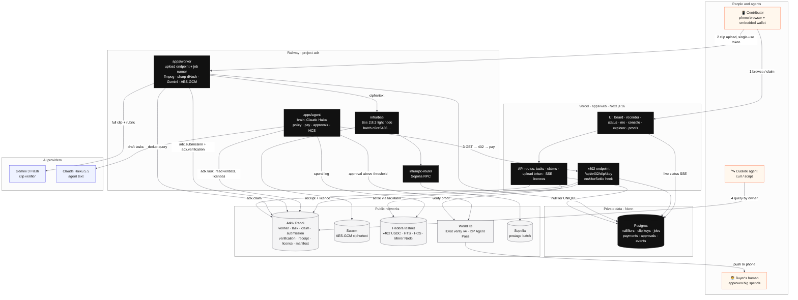

<details><summary>Mermaid source</summary>


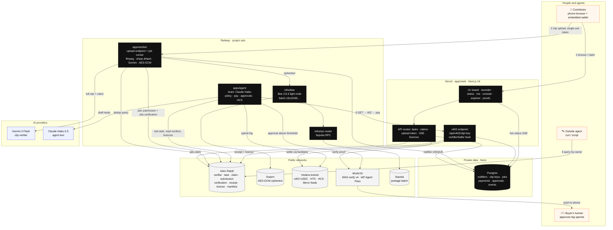

</details>

### 8.2 Deployment topology

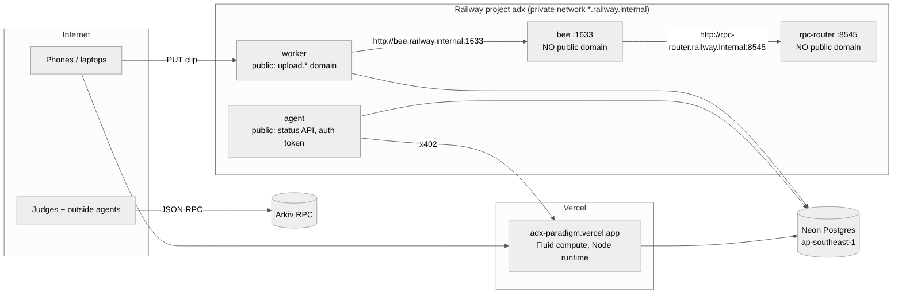

<details><summary>Mermaid source</summary>


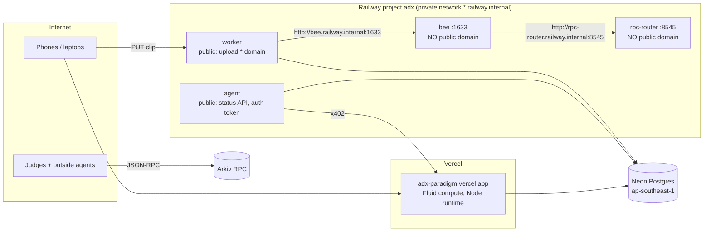

</details>

### 8.3 Where data lives

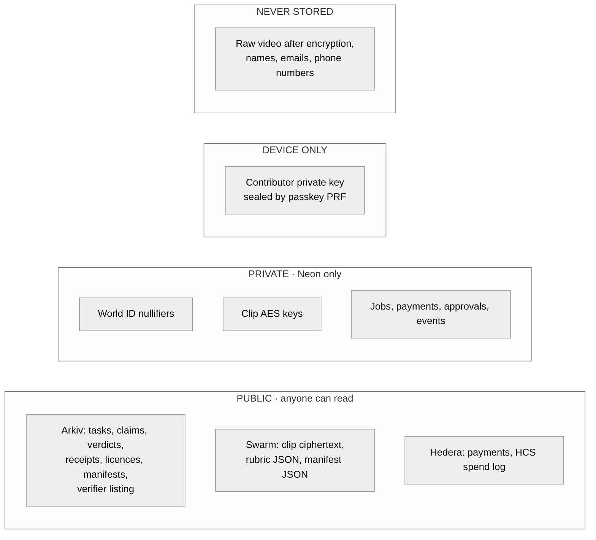

<details><summary>Mermaid source</summary>

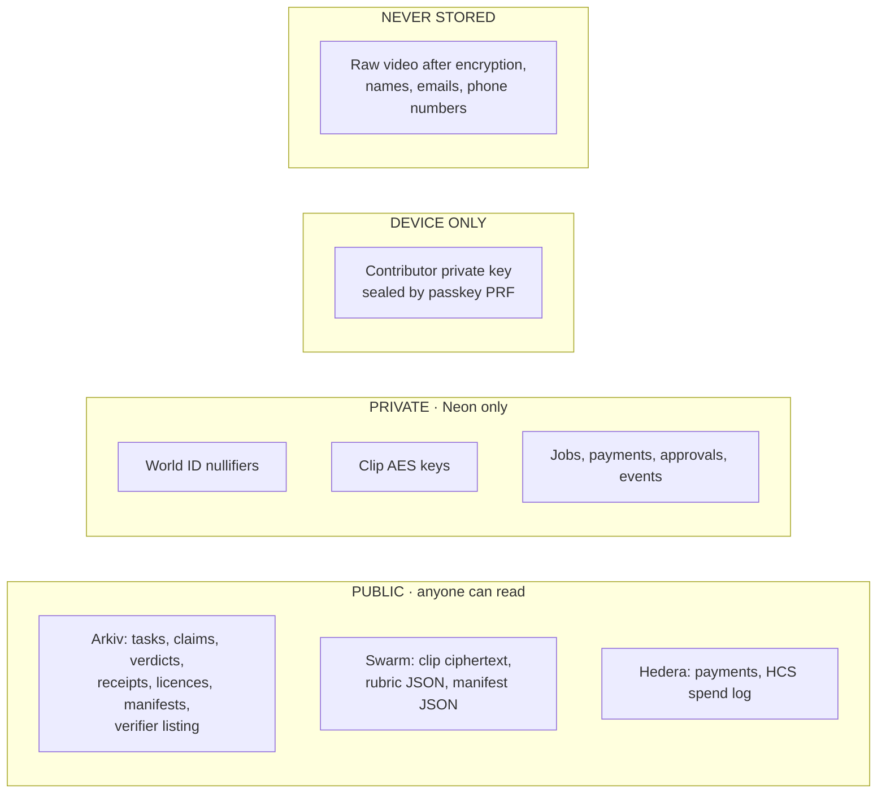

</details>

### 8.4 Sequence: claim a slot (IDKit)

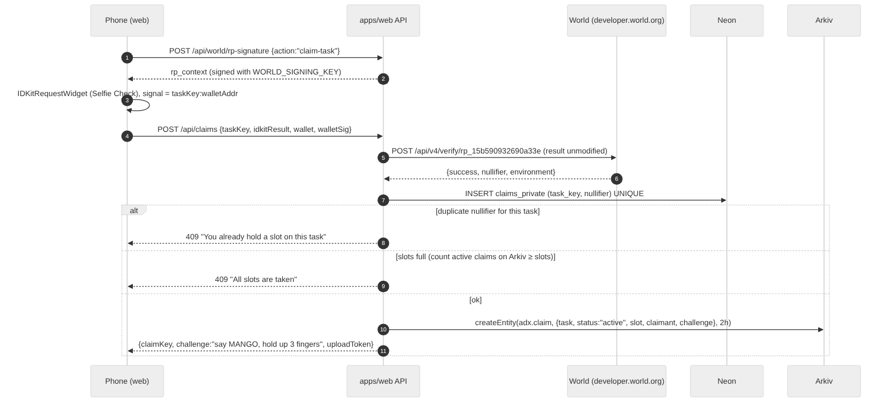

<details><summary>Mermaid source</summary>

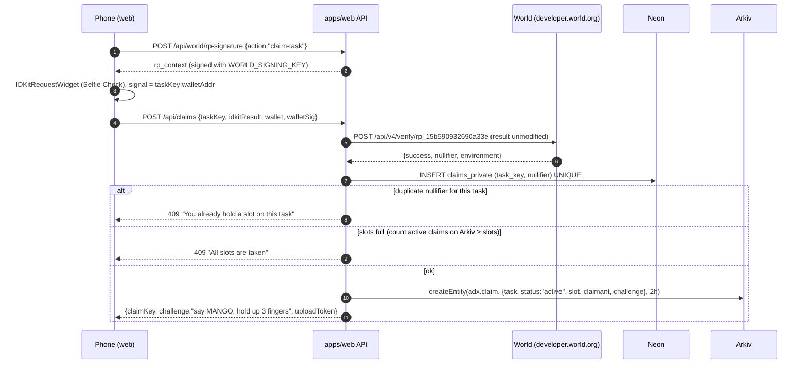

</details>

### 8.5 Sequence: upload → verify → publish

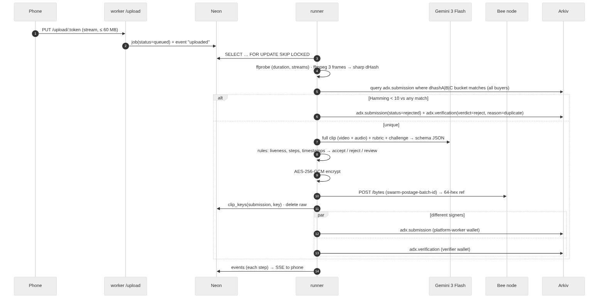

<details><summary>Mermaid source</summary>

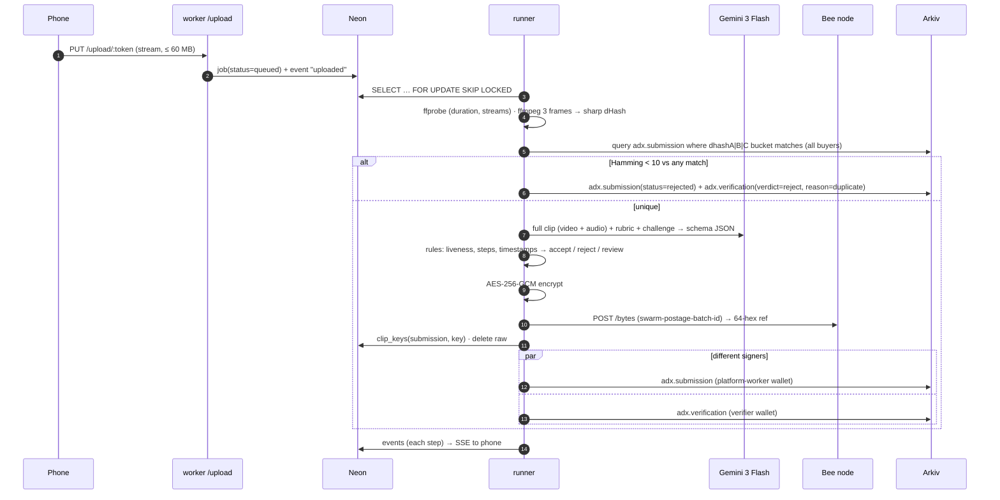

</details>

### 8.6 Sequence: autonomous payment (x402) and approval (Agent Pass)

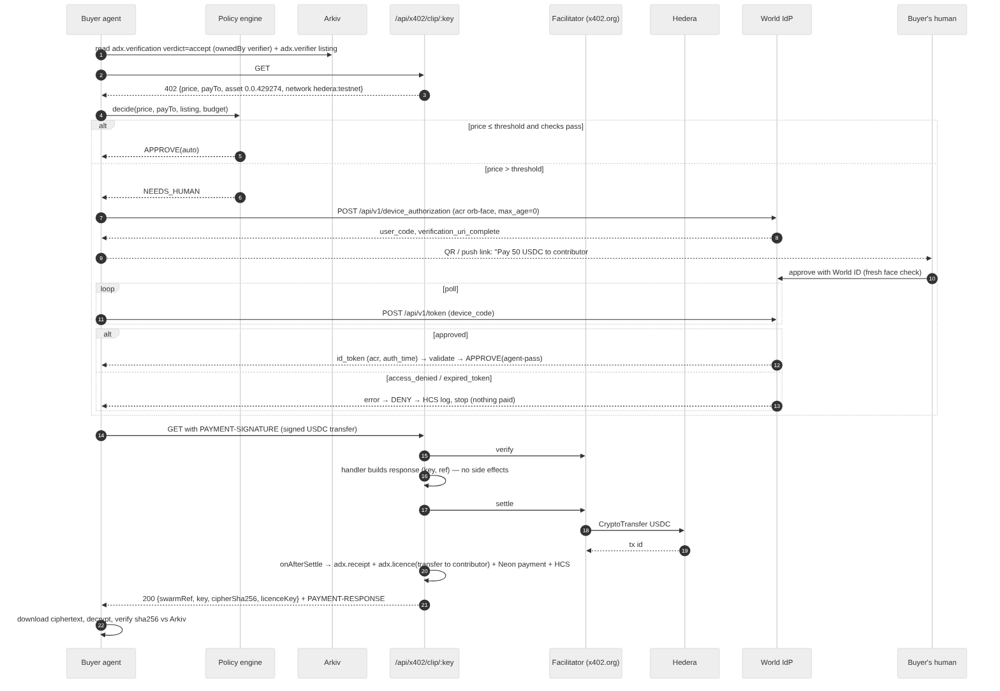

<details><summary>Mermaid source</summary>

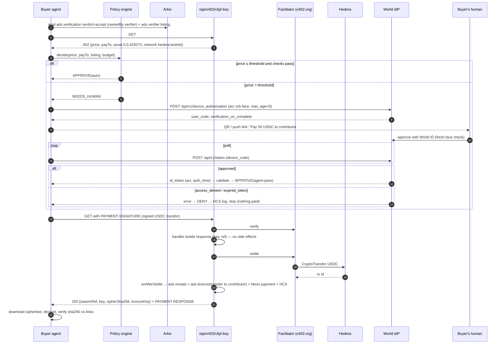

</details>

### 8.7 State machines

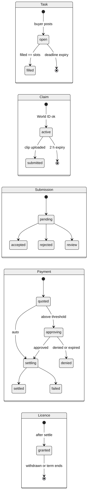

<details><summary>Mermaid source</summary>

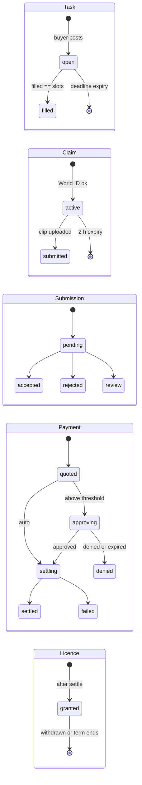

</details>

---

## 9. Modules in depth

### 9.1 `apps/web` — frontend
**Rendering strategy:** React Server Components for every read page (task board, explorer, proofs, me) with `fetch` caching (`revalidate: 5`) on Arkiv reads through a server helper; client components only for the recorder, IDKit sheet, wallet, live feed. Streaming with `Suspense` + skeletons. React Compiler on.

**Screens (mobile-first, 393 px design width):**
| Route | Purpose | Data | Key states |
|---|---|---|---|
| `/` | Landing: the loop in 4 steps, live counters (open tasks, distinct humans, USDC paid) read from Arkiv/Hedera | Arkiv count queries, Mirror Node | — |
| `/tasks` | Board of open tasks with reward, slots left, countdown from `$expiresAt` | `adx.task` status=open ownedBy buyer | skeleton, empty, Arkiv-down banner |
| `/tasks/[key]` | Rubric, example frames, "Claim" | `adx.task`, rubric from Swarm | claimed-by-you, full, expired |
| `/record/[claim]` | Full-screen camera, challenge overlay, 3-2-1, 15–30 s, retake/submit, upload progress | local | camera denied, too short, upload retry |
| `/submissions/[key]` | Live pipeline steps (SSE), final verdict card with timestamps, Swarm ref, Arkiv links | Neon events + Arkiv | each step loading/success/fail |
| `/me` | Embedded wallet (address, Hedera account, balance), earnings, licences with Withdraw | Arkiv `adx.licence` ownedBy me, Mirror Node | — |
| `/console` | Buyer side: policy (caps, threshold), live event feed, tasks, pending approvals with QR, spend log (HCS) | Neon, Arkiv, Mirror Node | — |
| `/explorer` | Live Arkiv explorer: pick a query, see the SDK code, the raw result and explorer links | Arkiv | — |
| `/proofs` | Every on-chain proof with links (mirror of PROOFS.md) | static + live | — |

**Key client modules:**
- `lib/wallet/` — create key (`generatePrivateKey`), seal with passkey PRF (AES-GCM, key from PRF output via HKDF), store ciphertext in IndexedDB; unlock on demand; `signMessage` for claim binding; `deleteEntity` for withdrawal (Arkiv wallet client in the browser, **public RPC with the user's own gas**, never our access key).
- `components/recorder.tsx` — `getUserMedia({video:{facingMode:"environment", width:1280, height:720, frameRate:30}, audio:true})`; `MediaRecorder` with `isTypeSupported` choosing `video/mp4;codecs=avc1` then `video/webm;codecs=vp9`; **`start(1000)`** (iOS freeze bug); 2.5 Mbps bitrate (≈ 9 MB for 30 s); `XMLHttpRequest` PUT for progress events.
- `components/live-feed.tsx` — `EventSource` to `/api/submissions/[key]/events`; renders step list with timings.
- `components/proof-badge.tsx` — small badge: "On Arkiv ↗", "Settled on Hedera ↗", "Stored on Swarm ↗", "Verified human (World ID)".

### 9.2 `apps/web` — backend (API routes, Node runtime)
| Route | Method | Auth | Request → Response | Notes |
|---|---|---|---|---|
| `/api/tasks` | GET | public | → `[{key,title,reward,slots,filled,expiresAt}]` | server cache 5 s |
| `/api/world/rp-signature` | POST | public | `{action}` → `{rp_id,nonce,created_at,expires_at,signature}` | `signRequest` from `@worldcoin/idkit-server`; action allowlist |
| `/api/claims` | POST | wallet signature | `{taskKey, idkit, wallet, sig}` → `{claimKey, challenge, uploadToken}` · 409 dup/full · 400 invalid proof | verify v4 → Neon UNIQUE → Arkiv claim; ensures contributor Hedera account (D-3) |
| `/api/uploads/token` | POST | claim owner | `{claimKey}` → `{url, token, expiresAt}` | HMAC token, single use, 15 min |
| `/api/submissions/[key]/events` | GET (SSE) | public | stream of `{step, ok, ms, ref?}` | polls Neon `events` every 750 ms, closes on terminal step |
| `/api/x402/clip/[key]` | GET | x402 | 402 / 200 `{swarmRef,key,cipherSha256,licenceKey}` / 404 | `withX402` from `@x402/next`; price from Arkiv task; hooks in §12 |
| `/api/licences` | GET | wallet sig | → my licences | Arkiv `ownedBy(wallet)` |
| `/api/licences/gas` | POST | wallet sig | → drip tGLM for withdrawal | rate-limited, once per wallet |
| `/api/approvals/[id]` | GET | console token | → approval status | for the console |
| `/api/auth/world/callback` | GET | OIDC | Agent Pass browser fallback (auth code + PKCE) | redirect URI registered |

All inputs validated with zod. Errors use one shape: `{error:{code,message}}`.

### 9.3 `apps/worker`
- **Upload server (Hono):** `PUT /upload/:token` verifies HMAC token (claim key, expiry, single use via Neon), streams body to `/tmp/clips/<id>` with a 60 MB cap, inserts job, returns `202 {submissionId}`. CORS for the web origin only. `GET /health`.
- **Runner:** concurrency 3; `SELECT … FROM jobs WHERE status='queued' ORDER BY created_at FOR UPDATE SKIP LOCKED LIMIT 1`; stages in §11; each stage writes an event; retries 3× with backoff, then `review`.
- **Arkiv signer queue:** one in-process queue per wallet (platform-worker, verifier) so writes are serialised per nonce; `predictEntityKeys` + idempotency key lookup before retrying uncertain writes.
- **Dockerfile:** `node:22-slim` + `apt-get install -y ffmpeg`; single stage, small image.

### 9.4 `apps/agent`
- **Loop (every 10 s):** (1) post tasks for unaddressed failure cases (if budget allows), (2) find accepted verdicts for its tasks, (3) for each, run the purchase flow, (4) refresh manifest, (5) re-check licences of clips it holds, drop withdrawn ones.
- **Brain (`brain.ts`):** Claude Haiku 5.5 with tools: `draft_task(failure)`, `explain_decision(...)`. The LLM writes task text and the human-readable rationale; it never moves money.
- **Policy (`policy.ts`):** pure function `decide(input, state) → {action: "pay"|"needs_human"|"skip", reason}` with unit tests for every rule.
- **Pay (`pay.ts`):** `@x402/fetch` + `createClientHederaSigner(buyer)`; only callable with a policy decision object (type-level guard + runtime check of decision hash).
- **Approval (`approval.ts`):** `openid-client` device authorization grant against `https://auth.world.org`; `claims={"id_token":{"acr":{"essential":true,"value":"https://world.org/oidc/acr/orb-face"}}}`, `max_age=0`; validates id_token; binds approval to `sha256(amount|payTo|submission)` in Neon.
- **HCS (`hcs.ts`):** topic created once by the operator; each decision → `TopicMessageSubmitTransaction` JSON `{t, action, amount, payTo, submission, reason, txId?}`; console reads it from the Mirror Node.
- **Status API (Hono):** `GET /state` for the console (bearer token).

### 9.5 `packages/shared`
- `arkiv/schemas.ts` — the 8 `defineSchema` definitions (§10.1).
- `arkiv/client.ts` — `publicClient` (access key, server only), `walletFor(role)`.
- `arkiv/guard.ts` — `assertPublicSafe(values)`: rejects keys matching /key|secret|nullifier|token|email|phone/i, 0x-prefixed 64-hex values in non-whitelisted columns, 128-hex Swarm refs, emails, phone numbers; throws `UnsafeArkivWrite`.
- `arkiv/queue.ts` — per-signer FIFO with retries and reconciliation.
- `arkiv/queries.ts` — every query the app uses, named (`openTasks`, `acceptedVerdictsFor`, `liveLicencesFor`, `submissionsByBucket`, …). The explorer page and README reuse these.
- `crypto.ts` — AES-256-GCM `encrypt/decrypt` (iv‖ct‖tag), sha256 helpers.
- `env.ts` — zod-validated env per service; fails fast at boot with the missing names (never values).
- `events.ts` — event types shared by worker, web and agent.

### 9.6 `packages/db` (Drizzle, §10.2) · 9.7 `infra/*` (done; see §1)

---

## 10. Data model

### 10.1 Arkiv schemas (code-level)
Canonical definitions; `arkiv/schema.md` is the judge-facing description of the same. Namespace prefix from `ARKIV_NS` (default `adx`) so a testnet reset can be recovered by bumping it.

```ts
// packages/shared/src/arkiv/schemas.ts
import { addr, bytes, dec, defineSchema, key, str, u64 } from "@arkiv-network/sdk/schema"
const ns = process.env.ARKIV_NS ?? "adx"

export const Verifier = defineSchema(`${ns}.verifier`, {
  skill: str().indexed(), status: str().indexed(), price: dec().indexed(),
  endpoint: str(), payTo: str(), model: str(),
})                                    // owner: verifier · expiry 24 h, extended hourly

export const Task = defineSchema(`${ns}.task`, {
  status: str().indexed(), skill: str().indexed(), reward: dec().indexed(),
  slots: u64().indexed(), filled: u64().indexed(), deadline: u64().indexed(),
  title: str(), failureTag: str(), rubricRef: str(), rubricHash: str(),
})                                    // owner: buyer agent · expiry = deadline

export const Claim = defineSchema(`${ns}.claim`, {
  task: key().indexed(), status: str().indexed(), slot: u64().indexed(),
  claimant: str(), challenge: str(),
})                                    // owner: platform-web · expiry 2 h → 24 h on submit

export const Submission = defineSchema(`${ns}.submission`, {
  task: key().indexed(), claim: key().indexed(), status: str().indexed(),
  dhashA: str().indexed(), dhashB: str().indexed(), dhashC: str().indexed(), // 4-hex buckets
  dhash: str(),                       // 3×16 hex full hashes, "a|b|c"
  swarmRef: str(), cipherSha256: str(), durationMs: u64(),
})                                    // owner: platform-worker · expiry 30 d

export const Verification = defineSchema(`${ns}.verification`, {
  submission: key().indexed(), task: key().indexed(), verdict: str().indexed(),
  score: u64().indexed(), model: str(), rubricHash: str(),
  evidence: bytes(), evidenceHash: str(),
})                                    // owner: verifier · expiry 180 d

export const Receipt = defineSchema(`${ns}.receipt`, {
  task: key().indexed(), submission: key().indexed(), mode: str().indexed(),
  network: str().indexed(), hederaTx: str(), usdc: dec(), payTo: str(), approval: str(),
})                                    // owner: verifier · expiry 180 d

export const Licence = defineSchema(`${ns}.licence`, {
  submission: key().indexed(), task: key().indexed(), licensee: addr().indexed(),
  status: str().indexed(), scope: str(), termsHash: str(),
})                                    // creator: platform-web · owner: contributor · expiry 90 d

export const Manifest = defineSchema(`${ns}.manifest`, {
  skill: str().indexed(), version: u64().indexed(),
  samples: u64(), humans: u64(), swarmRef: str(),
})                                    // owner: buyer agent · expiry 180 d
```
Constructor names verified against the installed SDK (`addr bool bytes dec i32 key str u256 u64`, plus `defineSchema`, `describeColumns`, `validateAttributeName`).

**Queries used (all owner-filtered):** `openTasks`, `taskByKey`, `activeClaimsForTask` (count), `submissionsByBucket(a|b|c)` (dedup, **not** owner-filtered on purpose: cross-buyer), `acceptedVerdictsFor(taskKeys)`, `receiptsFor(task)`, `liveLicencesFor(owner)`, `licencesFor(submissions)`, `liveVerifiers(skill)`, `latestManifest(skill)`.

### 10.2 Neon (private)
```sql
-- packages/db/src/schema.ts (Drizzle) — logical SQL
create table claims_private (
  id uuid primary key default gen_random_uuid(),
  task_key text not null, claim_key text, nullifier text not null,
  wallet text not null, created_at timestamptz default now(),
  unique (task_key, nullifier));
create table contributors (
  wallet text primary key, hedera_account text, last_upload_at timestamptz,
  created_at timestamptz default now());               -- cooldown lives here
create table upload_tokens (token_hash text primary key, claim_key text not null,
  expires_at timestamptz not null, used_at timestamptz);
create table jobs (id uuid primary key default gen_random_uuid(),
  claim_key text not null, task_key text not null, path text not null,
  status text not null default 'queued', attempts int default 0, error text,
  submission_key text, created_at timestamptz default now(), updated_at timestamptz);
create index on jobs (status, created_at);
create table clip_keys (submission_key text primary key, aes_key bytea not null,
  swarm_ref text not null, cipher_sha256 text not null, created_at timestamptz default now());
create table payments (id uuid primary key default gen_random_uuid(),
  submission_key text unique not null, amount numeric not null, pay_to text not null,
  status text not null, approval_id uuid, hedera_tx text, receipt_key text,
  licence_key text, created_at timestamptz default now(), updated_at timestamptz);
create table approvals (id uuid primary key default gen_random_uuid(),
  binding_hash text not null, amount numeric not null, pay_to text not null,
  submission_key text not null, status text not null,  -- pending|approved|denied|expired
  device_code text, user_code text, verification_uri text, approver_sub text,
  acr text, auth_time timestamptz, created_at timestamptz default now(), decided_at timestamptz);
create table events (id bigserial primary key, scope text not null, -- submission:<id> | agent
  step text not null, ok boolean not null, ms int, data jsonb, created_at timestamptz default now());
create index on events (scope, id);
```
Driver: `@neondatabase/serverless` (HTTP) on Vercel; `pg` pool over the pooler URL on Railway.

### 10.3 Swarm
- Uploads: `POST http://bee.railway.internal:1633/bytes`, header `swarm-postage-batch-id: c0cc5436…2665`, body = `iv(12) ‖ ciphertext ‖ tag(16)`. Response `{reference}` (64 hex).
- Public rubric and manifest JSON: same, unencrypted (no secrets inside).
- Reads: buyer agent fetches ciphertext from our Bee (private network) or any gateway (`https://api.gateway.ethswarm.org/bytes/<ref>`) and decrypts locally. Judges can open the gateway link (they get ciphertext — proof it's stored and private).

### 10.4 Hedera
- Accounts: §1 / `PAYMENTS.md`. USDC `0.0.429274` (6 decimals).
- HCS topic `ADX spend log` (created in P6.4; ID recorded in PROOFS).
- Mirror Node REST (`https://testnet.mirrornode.hedera.com/api/v1`): balances, transactions, topic messages for the console.

---

## 11. The verification pipeline

We don't train a model. One video-native AI call judges the clip; plain code makes the decision. Decided 6 Nov: **Gemini 3 Flash is the verifier** (it takes video *with* audio in one call). Claude can't take video or audio, so it would need frame extraction + a separate transcript; Claude Haiku is used by the buyer agent for text only.

### 11.1 Stages and latency budget (30 s clip, ~9 MB)
| # | Stage | Tool | Budget | Fails to |
|---|---|---|---|---|
| 1 | Probe: duration 15–35 s, has video + audio | ffprobe | 0.2 s | reject (specific reason) |
| 2 | Fingerprint frames: 3 frames at 25/50/75 % of the clip, 320 px | ffmpeg (one call) | 0.3 s | retry |
| 3 | Fingerprint: 64-bit dHash per frame | `sharp` (libvips) in TypeScript | < 20 ms | retry |
| 4 | Dedup: query Arkiv buckets across all buyers; Hamming distance < 10 on any frame → duplicate | Arkiv query + TS popcount | 0.6 s | reject "duplicate" |
| 5 | Verdict: watch the full clip with audio against the rubric + liveness challenge | **Gemini 3 Flash** (`gemini-3-flash-preview`), inline video ≤ 20 MB, else Files API; `responseSchema` JSON, temperature 0 | 5–10 s | retry once → `review` |
| 6 | Sanity rules (code) | timestamps inside the clip and ordered; schema valid; liveness both parts | < 1 ms | `review` |
| 7 | Encrypt | AES-256-GCM (Node crypto) | 0.1 s | retry |
| 8 | Store | our Bee node `/bytes` with batch `c0cc5436…` | 2–5 s | retry ×3, keep raw |
| 9 | Publish | Arkiv: submission (worker wallet) ∥ verification (verifier wallet) | ~7 s (parallel) | queue retry |
| | **Target after upload completes** | | **p50 ≤ 20 s, p95 ≤ 30 s** | |

Stages 2–4 run in parallel with stage 5 (dedup doesn't wait for the AI). Worker CPU per clip: well under 1 s; everything else is waiting on the network.

### 11.2 The verdict contract (anti-hallucination by design)
Gemini gets: the clip (video + audio), the rubric JSON (named steps, e.g. `grasp_corners`, `first_fold`, `second_fold`, `flatten`), the liveness challenge (word + finger count), and the clip duration. It must answer with this schema (enforced by `responseSchema`, validated again with zod):
```json
{ "liveness": { "word_heard": "mango|other|not_audible", "fingers_shown": 3, "fingers_visible": true },
  "steps": [ { "name": "grasp_corners", "status": "done|not_done|not_visible", "t": "00:04", "evidence": "both hands pinch two corners" } ],
  "quality": { "framing": "top_down|angled|unclear", "hands_visible": true, "lighting": "ok|dark" },
  "confidence": 0-100 }
```
Why this keeps it honest:
1. **"not_visible" / "not_audible" are always allowed**, so the model never has to invent an answer.
2. **Every claimed step needs a timestamp and a short evidence line**; code checks the timestamp is within the clip and steps are in order. An impossible answer → `review`.
3. **Code decides, not the model:** liveness word ≠ challenge or fingers ≠ challenge → reject; any required step `not_done` → reject; any `not_visible`, confidence < 70, or a failed sanity rule → `review`; otherwise accept. `score` written to Arkiv = confidence.
4. **Temperature 0 + strict schema**; the prompt forbids guessing and says "if you can't see it, say not_visible".
5. **Prompt injection:** text shown in the video can't change the outcome, because the verdict is only the schema fields and the rules above.
6. **Measured, not claimed:** §11.4.
Timestamps are whole seconds (Gemini samples video at ~1 fps); we never claim sub-second precision.

### 11.3 Fingerprint (dedup) detail
dHash: grayscale → resize 9×8 → 64 bits from horizontal gradients (`sharp().greyscale().resize(9,8,{fit:'fill'}).raw()`). Stored on Arkiv as three indexed 4-hex buckets (`dhashA/B/C`) plus the full `a|b|c` value. Re-encoded copies stay within a few bits; different scenes differ by > 20 bits. Unit tests cover identical, re-encoded and different images.

### 11.4 Evaluation (16 clips)
`eval/manifest.json`: 8 good folds, 4 incomplete folds, 2 wrong challenge word, 2 re-encoded re-uploads. `pnpm eval` runs the pipeline in dry mode (no Arkiv/Swarm writes) and prints false-accept rate, false-reject rate, duplicate catch rate and p50/p95 latency. Numbers go in the README as measured (B-5).

---

## 12. Payments and the spending policy
Full detail in `docs/build/PAYMENTS.md`. Engineering notes:
- `withX402(handler, routeConfig, server)` from `@x402/next`. `routeConfig.accepts[0].price` is computed per request from the Arkiv task reward (route config as a function; 🧪 confirm `@x402/next` supports dynamic price/payTo per request in P5.1, otherwise use `x402HTTPResourceServer` directly in the route).
- Hooks on `x402ResourceServer`: `onBeforeSettle` (re-check submission still accepted, payment row → `settling`), `onAfterSettle` (receipt, licence, payment `settled`, HCS), `onSettleFailure` (payment `failed`).
- 🧪 Per-request `payTo` = contributor's Hedera account. If the facilitator rejects alias/new accounts, pay the merchant and do an HTS transfer to the contributor in `onAfterSettle` (second tx ID on the receipt).
- Policy rules and defaults: per-clip cap 5 USDC, daily 20 USDC, allowlist from live `adx.verifier`, threshold 5 USDC, approval freshness 5 min, binding hash.

---

## 13. Identity

### 13.1 Embedded wallet (contributors)
1. First visit: `generatePrivateKey()` (viem). Create a passkey (`navigator.credentials.create`, `extensions.prf.eval.first = salt`). Derive an AES key via HKDF(PRF output). Encrypt the private key; store `{credentialId, iv, ciphertext}` in IndexedDB.
2. Unlock: `navigator.credentials.get` with PRF → decrypt in memory for the session.
3. Fallback when PRF is unavailable: non-extractable WebCrypto AES key in IndexedDB (device-bound) + "back up your wallet" export.
4. The same secp256k1 key is (a) the Arkiv owner address of the contributor's licences, (b) a Hedera ECDSA alias. On first claim the platform creates a Hedera account for the public key (`AccountCreateTransaction().setECDSAKeyWithAlias(pub).setMaxAutomaticTokenAssociations(-1)`), so USDC can arrive without the contributor signing an association. 🧪 confirm in P2.4.
5. Demo fallback: map the two demo phones to the pre-created contributor accounts `0.0.11333310/12`.

### 13.2 World IDKit (claim)
RP signing route → `IDKitRequestWidget` with the Selfie Check preset, `action: "claim-task"`, `signal: "<taskKey>:<wallet>"`, environment from env (staging for the Simulator) → backend forwards the result unmodified to `POST https://developer.world.org/api/v4/verify/rp_15b590932690a33e` → check `success`, environment, action, signal → Neon `UNIQUE(task_key, nullifier)`.
Trust moment (WI-3): claiming a scarce paid slot. Minimum sufficient credential: Selfie Check (uniqueness at low friction); Orb would exclude most contributors for a few-dollar task.

### 13.3 World Agent Pass (approval)
Device authorization grant (§9.4). Server-side validation: `iss = https://auth.world.org`, `aud = client_id`, RS256 via JWKS, `acr = orb-face`, `auth_time ≥ now − 300 s`, `nonce`, approver `sub` on the buyer's allowlist (recorded the first time the buyer signs in). Denied (`access_denied`), expired (`expired_token`, device code lives 20 min) and `invalid_grant` all end the flow with no payment. `503` is never approval. Browser fallback: auth-code + PKCE on `/approve/[id]` with the registered redirect URI.

---

## 14. UX and design system
- **Identity:** neutral greys (zinc scale) on near-black / near-white, one accent: Arkiv orange `#FE7446` for primary actions and "on-chain" moments. Sponsor proof badges use each sponsor's own mark in monochrome plus the accent dot.
- **Type:** Geist Sans for UI, Geist Mono for keys, hashes and code (both OFL).
- **Themes:** light + dark via CSS variables and `prefers-color-scheme`, toggle in the header.
- **Components:** shadcn/ui (Radix) + Tailwind 4; Magic UI only for 2–3 moments (number ticker on counters, border beam on the active pipeline step). Motion ≤ 200 ms, `prefers-reduced-motion` respected.
- **Mobile-first rules:** thumb-reach primary buttons, one primary action per screen, no hover-only affordances, 44 px targets, safe-area insets on the recorder.
- **Every on-chain thing is clickable:** entity key → Arkiv explorer, tx → HashScan/Etherscan, ref → Swarm gateway.
- **Design workflow:** frontend-design skill for direction; `npx @airshiplabs/cli --target 3000` (Airship, MIT) to tweak the running app visually with Claude Code (no sandbox by default: run it only in this repo); `find-animation-opportunities` and `better-interface` skills once near the end.
- **From-scratch rule:** tessera-guard / d3coy are mood references only. No code, components, images or design files are copied (E-1).

---

## 15. Security and threat model
| Threat | Defence |
|---|---|
| Sybil contributors farming slots | IDKit nullifier `UNIQUE(task, nullifier)`; Selfie Check; cooldown per wallet |
| Re-uploading the same clip to many buyers | Cross-buyer dHash buckets on public Arkiv + Hamming check |
| Pre-recorded / fake clips | Random spoken word + finger count per claim, checked by transcript + vision |
| Prompt injection via the video (text in frame) | Verdict limited to schema fields, validated with zod; code rules decide; the verifier has no tools |
| Agent overspending / prompt-jacked agent | Deterministic policy, key only behind `pay.ts`, decision binding, daily cap |
| Forged approval | Server-side id_token validation (iss/aud/acr/auth_time/nonce/sub allowlist), binding hash |
| Fake entities with our schema names | Every read filters by our owner wallets |
| Secret leakage to Arkiv | Write guard; schema has no free-text secret columns; Swarm refs are ciphertext-only |
| Key release without payment | Key only in the 200 body after settlement; receipt only in `onAfterSettle` |
| Upload abuse | HMAC single-use tokens, 60 MB cap, content-type check, rate limit per wallet |
| Open Bee API | No public domain; private network only |
| Contributor privacy on Hedera | Fresh claimant pseudonym per claim on Arkiv; HashScan shows only account IDs |

**Secrets (names only):** `ARKIV_ACCESS_KEY`, `ARKIV_*_PRIVATE_KEY` (per role), `HEDERA_*_KEY`, `WORLD_SIGNING_KEY`, `WORLD_AGENTPASS_CLIENT_SECRET`, `ANTHROPIC_API_KEY`, `GEMINI_API_KEY`, `DATABASE_URL`, `UPLOAD_TOKEN_SECRET`, `AGENT_STATUS_TOKEN`, `BEE_PASSWORD`, `BEE_SWARM_KEY_JSON`, `SWARM_FUNDER_PRIVATE_KEY`.

---

## 16. Performance budget and metrics
| Metric | Target | Measured how |
|---|---|---|
| Task board LCP on 4G phone | < 1.5 s | Vercel Speed Insights / Lighthouse |
| JS on `/record` | < 120 kB gz | `next build` output |
| Claim (tap → slot reserved) | p50 ≤ 9 s (World + Arkiv write) | events table |
| Upload 9 MB on venue Wi-Fi | ~5–10 s | XHR progress |
| Pipeline after upload | p50 ≤ 20 s, p95 ≤ 30 s | events table |
| x402 purchase (402 → 200) | ≤ 4 s | agent logs (smoke: 2.2 s) |
| Verifier accuracy | report measured FAR / FRR on 16 clips | `pnpm eval` |

---

## 17. Observability and testing
- **Events:** every step writes `events(scope, step, ok, ms, data)`; the console and status pages render them live. Worker and agent log JSON lines to Railway.
- **Unit (Vitest):** guard, policy, crypto, schema round-trip, verdict rules, token signing.
- **Fingerprint tests:** dHash properties (§11.3).
- **Integration scripts:** existing smoke tests + `seed:arkiv`, `outside-agent`, `doctor` (env + connectivity check for every service).
- **E2E (Playwright):** Chromium with fake camera (`--use-fake-device-for-media-stream`, `--use-file-for-fake-video-capture=eval/sample.y4m`) runs claim (World staging/simulator) → upload → verdict on the preview URL.
- **Manual gate before each merge to main:** a real iPhone recording ≥ 18 s and an Android recording.

---

## 18. Configuration: environment variables per service
| Variable | web | worker | agent | Notes |
|---|---|---|---|---|
| `ARKIV_ACCESS_KEY`, `ARKIV_NS` | ✓ | ✓ | ✓ | |
| `ARKIV_PLATFORM_WEB_KEY` | ✓ | | | claims, licence create |
| `ARKIV_PLATFORM_WORKER_KEY` | | ✓ | | submissions |
| `ARKIV_VERIFIER_KEY` | ✓ (receipts) | ✓ (verdicts) | | separate queues per process |
| `ARKIV_BUYER_KEY` | | | ✓ | tasks, manifests |
| `DATABASE_URL` | ✓ | ✓ | ✓ | pooler URL |
| `WORLD_APP_ID`, `WORLD_RP_ID`, `WORLD_SIGNING_KEY`, `WORLD_ACTION`, `WORLD_ENV` | ✓ | | | |
| `WORLD_AGENTPASS_*` | ✓ | | ✓ | |
| `HEDERA_OPERATOR_*`, `HEDERA_MERCHANT_ID`, `HEDERA_USDC_TOKEN_ID` | ✓ | | ✓ | |
| `HEDERA_BUYER_ID`, `HEDERA_BUYER_KEY`, `HEDERA_SPEND_TOPIC_ID` | | | ✓ | |
| `FACILITATOR_URL` | ✓ | | | |
| `UPLOAD_TOKEN_SECRET`, `WORKER_PUBLIC_URL` | ✓ | ✓ | | |
| `BEE_URL`, `SWARM_BATCH_ID` | | ✓ | ✓ | `http://bee.railway.internal:1633` |
| `GEMINI_API_KEY` | | ✓ | | verifier |
| `ANTHROPIC_API_KEY` | | | ✓ | agent text |
| `AGENT_STATUS_URL`, `AGENT_STATUS_TOKEN` | ✓ | | ✓ | |

---

## 19. Build plan

### 19.1 Difficulty ranking (hardest first) and build order
| Rank | Phase | Difficulty (1–5) | Why it's hard |
|---|---|---|---|
| 1 | **P6 Buyer agent + policy + Agent Pass** | 5 | Device flow against a new IdP, id_token validation, policy guarantees, HCS |
| 2 | **P5 Payments (x402 + hooks + licences)** | 5 | Dynamic pricing in `withX402`, settle-after-handler semantics, per-request payTo |
| 3 | P2 Identity (embedded wallet + IDKit + Hedera alias) | 4 | WebAuthn PRF across iOS/Android, IDKit 4 RP signing |
| 4 | P4 Verification pipeline | 4 | One AI call with strict rules, Swarm, parallel Arkiv writes, live status |
| 5 | P1 Arkiv core | 3 | Schemas are the foundation; nonce-safe queues |
| 6 | P3 Capture & upload | 3 | iOS MediaRecorder quirks, resumable upload |
| 7 | P7 Licences, outside agent, manifest | 3 | Ownership transfer, browser-side delete |
| 8 | P8 Console + landing + polish | 3 | Many screens, design quality |
| 9 | P9 Eval + hardening | 3 | Recording 16 clips, fixing what it reveals |
| 10 | P0 Foundation | 2 | Tooling |
| 11 | P10 Docs, video, submission | 2 | Volume, not difficulty |

**Order we build in** (dependencies first, hardest work started as early as the order allows, visible result after every phase):

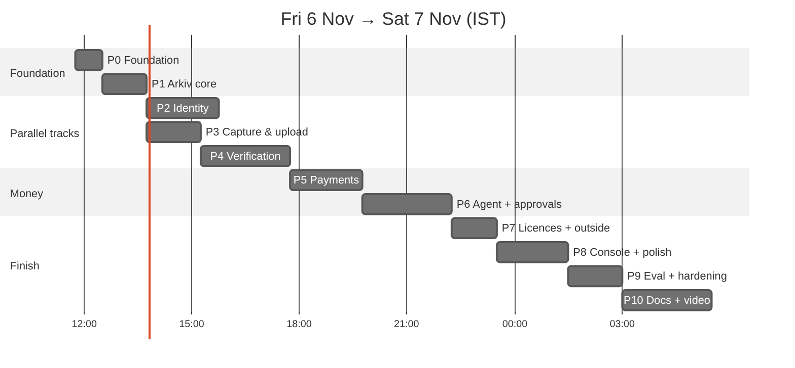

```mermaid
gantt
  dateFormat HH:mm
  axisFormat %H:%M
  title Fri 6 Nov → Sat 7 Nov (IST)
  section Foundation
  P0 Foundation           :p0, 11:45, 45m
  P1 Arkiv core           :p1, after p0, 75m
  section Parallel tracks
  P2 Identity             :p2, after p1, 120m
  P3 Capture & upload     :p3, after p1, 90m
  P4 Verification         :p4, after p3, 150m
  section Money
  P5 Payments             :p5, after p4, 120m
  P6 Agent + approvals    :p6, after p5, 150m
  section Finish
  P7 Licences + outside   :p7, after p6, 75m
  P8 Console + polish     :p8, after p7, 120m
  P9 Eval + hardening     :p9, after p8, 90m
  P10 Docs + video        :p10, after p9, 150m
```
Feature freeze when P8 ends (target Fri ~23:30–Sat 00:30). If behind schedule, the cut order is: H-6 HCS-14 profile → passkey PRF (use device key) → manifest entity → landing animations. **Never cut:** Arkiv reads in UI, x402 autonomous payment, Agent Pass denied path, IDKit duplicate path, Swarm with our batch, docs.

---

### P0 — Foundation (difficulty 2) · ~45 min
**Goal:** monorepo tooling that every later phase plugs into without friction.

**P0.1 Workspace and tooling**
- Root `package.json` scripts: `dev`, `build`, `lint`, `test`, `typecheck`, keep existing smoke scripts. Add Biome (`biome.json`: 2-space, single quotes off, line width 110). TypeScript `tsconfig.base.json` (strict, `moduleResolution: bundler`, `verbatimModuleSyntax`).
- Create `packages/shared` and `packages/db` with `package.json` (`"type":"module"`, `exports` → `src/index.ts`), consumed by apps via `workspace:*`. Next config `transpilePackages: ["@adx/shared","@adx/db"]`.
- **Acceptance:** `pnpm typecheck` and `pnpm lint` pass across the workspace.

**P0.2 Env validation**
- `packages/shared/src/env.ts`: zod schemas per service (`webEnv`, `workerEnv`, `agentEnv`) reading `process.env`; on failure print missing names and exit.
- `scripts/doctor.ts`: loads `.env`, checks each provider (Arkiv block number, Neon `select 1`, Hedera mirror account, World discovery, Anthropic `models.list`, Bee health via Railway — skipped locally).
- **Acceptance:** `pnpm doctor` prints a green table. **You'll see:** one table with every dependency ✓/✗.

**P0.3 Database**
- `packages/db`: Drizzle schema from §10.2, `drizzle.config.ts`, `pnpm db:push` against Neon; client factory (`neon-http` for web, `pg` Pool for Railway).
- **Acceptance:** tables exist (`psql \dt`).

**P0.4 Design tokens and app shell**
- `apps/web`: shadcn init (Tailwind 4), Geist fonts, CSS variables for light/dark (zinc + `--accent: #FE7446`), header with theme toggle, bottom nav on mobile (Tasks · Record · Me · Console), PWA manifest + icons (our own generated mark).
- **Acceptance:** deploy preview shows the shell in both themes on a phone. **You'll see:** the empty app shell on adx-paradigm.vercel.app.

### P1 — Arkiv core (difficulty 3) · ~75 min
**Goal:** the shared data layer, nonce-safe writes, and the first user-facing reads.

**P1.1 Schemas and clients** — write §10.1 schemas; confirm constructor names from `node_modules/@arkiv-network/sdk/dist/schema`. `client.ts` with `publicClient` and `walletFor(role)` reading role keys; generate the four role wallets (`scripts/arkiv-wallets.ts`: creates keys into `.env` if missing, prints addresses), fund each from the funder with the faucet (user claims tGLM per wallet if needed; 10 tGLM covers thousands of writes). **Acceptance:** unit test creates and reads each schema on Rabdi under `ARKIV_NS=adx-test`.

**P1.2 Write guard** — `guard.ts` + tests (secret-looking keys/values rejected; normal values pass). Every wallet write in the codebase calls `safeCreate/safePatch/...` wrappers that run the guard. **Acceptance:** tests pass; a write containing a 64-hex string in `title` throws.

**P1.3 Signer queue** — `queue.ts`: per-signer promise chain, 3 retries, on timeout reconcile by querying for the idempotency attribute (`$key` predicted with `predictEntityKeys` where possible). **Acceptance:** 10 parallel creates on one signer all land, no nonce errors.

**P1.4 Queries + seed** — `queries.ts` (§10.1 list). `scripts/seed-arkiv.ts`: writes the `adx.verifier` listing (endpoint `https://adx-paradigm.vercel.app/api/x402/clip`, price, payTo) and one demo task "Fold a towel, top-down" (3 slots, 3 USDC, 24 h) with rubric JSON uploaded to Swarm. Heartbeat job lives in the agent later (P6). **Acceptance:** `pnpm seed:arkiv` prints entity keys + explorer links; rows added to PROOFS.

**P1.5 First user-facing reads** — `/tasks` (RSC) listing open tasks with countdowns; `/explorer` with 4 named queries showing SDK code, JSON result, explorer links. **Acceptance (T-ARK-2):** board on the live URL shows the seeded task; explorer returns the same key. **You'll see:** the seeded task live on the phone, read straight from Arkiv.

### P2 — Identity (difficulty 4) · ~2 h (parallel with P3)
**P2.1 Embedded wallet** — `lib/wallet/` per §13.1 (PRF path + fallback), `useWallet()` hook, `/me` shows address. **Acceptance:** wallet survives reload; works in iOS Safari and Android Chrome (or falls back cleanly). **You'll see:** your contributor address on `/me`.

**P2.2 IDKit RP signing + widget** — install `@worldcoin/idkit@4.6.0 @worldcoin/idkit-server@1.2.0`; `/api/world/rp-signature`; `ClaimButton` opens `IDKitRequestWidget` (Selfie Check preset, staging env for Simulator). **Acceptance:** Simulator proof returns to the client.

**P2.3 Claim API** — `/api/claims`: verify v4, check signal/action/env, wallet signature over `claim:<taskKey>:<nonce>`, Neon UNIQUE, count active claims (Arkiv count query) vs slots, write `adx.claim` (2 h), random challenge (word list of 200 short words + finger count 1–5), issue upload token. **Acceptance (T-WLD-1):** first claim ok; same human again → 409 "You already hold a slot"; cancel → no claim row. **You'll see:** the challenge card after claiming; the duplicate error on the second try.

**P2.4 Contributor Hedera account** 🧪 — on first claim, create an account for the wallet's public key with alias + unlimited auto-associations; store in `contributors`. If `setMaxAutomaticTokenAssociations(-1)` or alias creation fails, fall back to demo account mapping. **Acceptance:** HashScan shows the new account; a 0.01 USDC test transfer to it succeeds.

### P3 — Capture and upload (difficulty 3) · ~90 min (parallel with P2)
**P3.1 Recorder** — `/record/[claim]` per §9.1 (back camera, challenge overlay, countdown, 15–30 s limits, preview, retake). **Acceptance:** 30 s clip records on iPhone without freezing past 15 s.

**P3.2 Worker upload server** — `apps/worker` scaffold (Hono, zod env), `PUT /upload/:token` streaming to disk, token verify (HMAC + single use), job insert, CORS to the web origin. Deploy to Railway with a public domain (`railway domain`). **Acceptance:** curl upload with a valid token → 202; reused token → 409; 70 MB → 413.

**P3.3 Upload UX** — XHR PUT with progress, auto-retry on network error (3×), then redirect to `/submissions/[id]`. **You'll see:** a real progress bar, then the status page.

### P4 — Verification pipeline (difficulty 4) · ~2.5 h
**P4.0 Spikes first (15 min)** 🧪 — (a) our Bee node reports batch `c0cc5436…` usable (worker boot check logs `GET http://bee.railway.internal:1633/stamps/<id>`); (b) Gemini 3 Flash on a 30 s, 9 MB clip inline with `responseSchema`: latency + whether it hears the word; (c) inline size limit vs Files API. Record results in the session logs.

**P4.1 Media stage** — `probe.ts` (ffprobe JSON: duration, streams), `frames.ts` (one ffmpeg call → 3 PNGs at 25/50/75 %, 320 px). **Acceptance:** outputs for a sample clip in < 0.5 s.

**P4.2 Fingerprint + dedup** — `fingerprint.ts` (sharp dHash + tests), `dedup.ts` (query `submissionsByBucket` for the 3 buckets with `or`, Hamming in TS). **Acceptance (T-VER-1):** a re-encoded copy of an accepted clip is rejected with the matching submission key.

**P4.3 Gemini verdict** — `verify.ts` (`@google/genai`, inline video or Files API, `responseSchema`, temperature 0, one retry), `rules.ts` (decision rules from §11.2, unit-tested with fixture JSON including bad timestamps and not_visible cases). **Acceptance (T-VER-2):** good fold → accept with ≥ 3 timestamped steps; wrong word → reject; ambiguous → review.

**P4.4 Encrypt + Swarm** — `encrypt.ts`, `swarm.ts` (`POST /bytes` with the batch header), `clip_keys` row, delete raw. **Acceptance (T-SWM-1):** ref downloads from the public gateway and decrypts with the stored key to the same sha256.

**P4.5 Publish + live status** — `publish.ts`: submission (worker wallet) ∥ verification (verifier wallet) through the signer queues; patch claim → `submitted`; an event per stage; `/submissions/[key]` SSE page with step list and verdict card (timestamps, evidence lines, Swarm + Arkiv links). **Acceptance:** phone sees each stage tick live; entities visible on the Arkiv explorer. **You'll see:** the whole check animate on the phone in ~20 s.

### P5 — Payments (difficulty 5) · ~2 h
**P5.1 Endpoint** 🧪 — `/api/x402/clip/[key]` with `withX402`; per-request price from the task, `payTo` per §12. 404 for non-accepted. Test with `scripts/x402-smoke.ts` pointed at the deployed route. **Acceptance (T-PAY-1):** 402 → paid → 200 on the preview URL; tx on HashScan.

**P5.2 Hooks** — `onBeforeSettle` (still accepted, payment row `settling`, idempotent on submission), `onAfterSettle` (receipt entity with `mode:"live"`, `approval`, tx id; licence create + `changeOwnership` to contributor wallet; payment `settled`), `onSettleFailure`. **Acceptance (T-PAY-2):** forced settlement failure (bad facilitator URL) → no receipt, no key, payment `failed`.

**P5.3 Contributor payout routing** 🧪 — test payTo = contributor account; else merchant + HTS transfer in `onAfterSettle`. **Acceptance:** contributor's HashScan shows incoming USDC.

### P6 — Buyer agent, policy and Agent Pass (difficulty 5) · ~2.5 h
**P6.1 Policy engine** — `policy.ts` + exhaustive unit tests (cap, budget, allowlist, threshold, binding). **Acceptance:** tests green.

**P6.2 Agent loop + brain** — `main.ts` loop, `brain.ts` drafts tasks from `failures.json` with Claude, posts `adx.task`; finds accepted verdicts; heartbeat-extends the `adx.verifier` listing hourly. Deploy to Railway. **Acceptance (T-AGT-1):** a new task appears on the board without a human; an accepted clip gets paid automatically (≤ threshold).

**P6.3 Agent Pass approvals** 🧪 — `approval.ts` device flow; approvals table; console shows the QR/link; id_token validation. **Acceptance (T-WLD-2/3, T-AGT-2/3):** above-threshold payout waits; approve → paid with `approval:"agent-pass"`; deny or let expire → nothing paid, console says why.

**P6.4 HCS spend log** — create topic (operator), submit every decision, console reads Mirror Node. Optional: Hedera Agent Kit for the HCS + transfer tools (H-11). **Acceptance (T-AGT-4):** HashScan topic shows the messages.

### P7 — Licences, outside agent, manifest (difficulty 3) · ~75 min
**P7.1 My licences + withdraw** — `/me` lists `adx.licence` owned by the wallet; gas drip; Withdraw = browser `deleteEntity`. **Acceptance (T-LIC-1):** licence disappears from Arkiv; agent's next pass drops the clip (event in console).

**P7.2 Outside agent** — `scripts/outside-agent.ts` (no imports from our app except schema names; or plain JSON-RPC) + README `curl`. **Acceptance (T-E2E-1):** prints the same tasks, verdicts, receipts and licences as the UI.

**P7.3 Manifest** — agent writes/updates `adx.manifest` with samples + distinct humans; manifest JSON on Swarm. **Acceptance:** landing counters match the manifest.

### P8 — Console, landing, polish (difficulty 3) · ~2 h
Console (policy panel, live feed, approvals, spend log), landing with live counters, proof badges everywhere, empty/error states from `FLOWS.md`, Airship pass, animation pass (≤ 3 moments), Lighthouse on mobile. **Acceptance:** §16 targets met; a non-technical teammate completes a claim → record → status without help.

### P9 — Eval and hardening (difficulty 3) · ~90 min
Record the 16 clips, `pnpm eval`, fix what fails, security review of routes (Trail of Bits skills: insecure-defaults, sharp-edges on policy/guard), rate limits, `seed:arkiv` reset drill (bump `ARKIV_NS`). **Acceptance:** confusion matrix in README; reset drill under 10 min.

### P10 — Docs, video, submission (difficulty 2) · ~2.5 h
`/arkiv/` five files + `swarm.md` (from session logs + queries), README (setup, architecture diagram, payment flow, tx IDs, writer wallets, `curl` query, measured numbers, "what we used"), `docs/sponsors/WORLD-DEBRIEF.md`, `AI_USAGE.md` final, clean screenshots into `docs/proofs/`, record video per `DEMO-SCRIPT.md`, submit with Hedera + Arkiv (+Swarm) + World (all tracks ticked). **Acceptance:** every row in §20 ticked.

---

## 20. Sponsor deliverables and submission checklist
| ✓ | Item | Req |
|---|---|---|
| ⬜ | README: setup, architecture, payment flow, ≥ 1 Hedera tx ID | H-3, HN-3 |
| ⬜ | Video ≤ 4 min with HashScan link and Swarm moment timestamp | H-4, S-2, E-6 |
| ⬜ | README: Arkiv writer wallets + runnable query | A-3 |
| ⬜ | `/arkiv/schema.md`, `friction.md`, `reach.md`, `why-arkiv.md`, `how-you-use-arkiv.md` | A-4, A-5 |
| ⬜ | `/arkiv/swarm.md` with entity key ↔ ref link, batch + wallet, Bee node, files, steps, video moment, friction | S-2 |
| ⬜ | World debrief (Agent Pass + IDKit) | W-5, WI-5 |
| ⬜ | `AI_USAGE.md`, `docs/planning/`, this doc | E-4, E-5 |
| ⬜ | Partner prizes selected: Hedera, Arkiv (+Swarm bonus), World | E-3 |

## 21. Risks and fallbacks
| Risk | Fallback |
|---|---|
| Arkiv testnet reset | bump `ARKIV_NS`, `pnpm seed:arkiv` |
| Bee node can't upload (batch not usable) | public gateway for uploads (still encrypted), note in `swarm.md` |
| Batch runs out (~2.9 days) | top up with more sBZZ (`swarm:fund` + topUp) |
| Agent Pass device flow unsupported | browser auth-code + PKCE approval page |
| Per-request payTo rejected | merchant + HTS transfer |
| PRF unavailable on a phone | device-bound key fallback |
| Venue network fails during live demo | pre-recorded full run |
| AI provider outage | Gemini retry → `review` (human queue) |

## 22. References
**Local paths**
- Repo: `~/ethglobal-mumbai/adx` · planning: `~/ethglobal-mumbai/00-SESSION-BRIEF.md`, `03-DECISIONS-AND-OPEN-QUESTIONS.md`, `research/01–13`
- Secrets: `~/ethglobal-mumbai/adx/.env` (git-ignored) · env names: `.env.example`
- Sponsor docs: `docs/sponsors/` · build docs: `docs/build/` · Arkiv files: `arkiv/`

**Live**
- App: https://adx-paradigm.vercel.app · Repo: https://github.com/Abhishek222983101/agentic-data-exchange
- Railway project `adx`: services `bee`, `rpc-router` (+ `worker`, `agent` to add)

**Docs**
- ETHGlobal rules: https://ethglobal.com/events/mumbai/info/details · prizes: https://ethglobal.com/events/mumbai/prizes
- Arkiv: https://docs.arkiv.network · hub https://hub.arkiv.network · explorer https://rabdi.explorer.arkiv.network · AI tools https://hub.arkiv.network/ai-tools
- Swarm: https://docs.ethswarm.org · bee-js https://bee-js.ethswarm.org · PostageStamp (Sepolia) `0xcdfdC3752caaA826fE62531E0000C40546eC56A6`
- Hedera x402: https://docs.hedera.com/solutions/ai/x402 · facilitators https://docs.hedera.com/solutions/ai/x402/facilitators · x402 repo https://github.com/x402-foundation/x402 · Agent Kit https://docs.hedera.com/solutions/ai/agent-kit · Mirror Node https://docs.hedera.com/reference/rest-api · HashScan https://hashscan.io/testnet
- World: IDKit https://docs.world.org/world-id/idkit/integrate · credentials https://docs.world.org/world-id/idkit/credentials · Agent Pass (World IdP) https://auth.world.org/docs · coding-agent setup https://auth.world.org/docs/guides/coding-agent-setup · Simulator https://simulator.worldcoin.org
- AI: Gemini (`gemini-3-flash-preview`, clip verifier), Anthropic (`claude-haiku-5-5`, agent text)
- Design: shadcn/ui, Magic UI, Airship https://www.airship.design (`npx @airshiplabs/cli --target 3000`)
