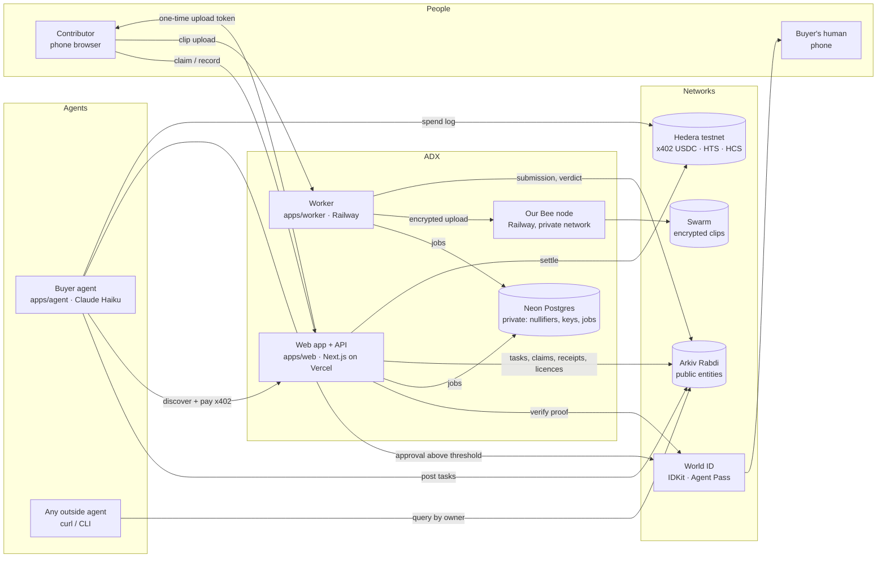

# Paradigm — Architecture

*Internal code name: ADX.*

## System at a glance

## Components

| Component | Runs on | Does |
|---|---|---|
| `apps/web` | Vercel (Next.js 16.4.5) | Contributor UI (task board, claim, record, earnings, licences), buyer console (budget, policy, approvals, spend log), API routes, the x402-protected endpoint |
| `apps/worker` | Railway (Node 22 + ffmpeg) | Receives the phone upload (one-time token, size + type checks), then: probe, dHash fingerprint + cross-buyer duplicate check on Arkiv, Gemini 3 Flash watches the clip, code decides, AES-256-GCM encryption, Swarm upload via our Bee node, Arkiv writes, Swarm read-back for judges |
| `apps/agent` | Railway or a laptop (Node) | The buyer agent: reads failure cases, posts tasks, watches verdicts, pays over x402 within its policy, asks for human approval above the threshold, checks licences, logs spend to HCS |
| `infra/bee` | Railway (Bee 2.8.3 light node, Sepolia) | Our own Swarm node with our own postage batch. No public domain: only reachable on Railway's private network |
| `packages/shared` | — | Arkiv schemas, policy types, crypto helpers, env validation, the Arkiv write guard |

## Where data lives (and why)

| Data | Where | Why |
|---|---|---|
| Tasks, claims, submissions, verdicts, receipts, licences, verifier listing | **Arkiv** (public) | Anyone can query them; owner wallets prove who said what; expiry is the business logic |
| Clip bytes | **Swarm** (AES-256-GCM ciphertext) | Large files, decentralised, content-addressed; only ciphertext ever leaves our side |
| Clip decryption keys | **Neon** (private) | Must never be public; released to the buyer only after payment settles |
| World ID nullifiers | **Neon**, `UNIQUE(task_id, nullifier)` | Proves one human per slot without putting identity on-chain |
| Raw upload before encryption | **Worker disk** (deleted after encryption) | Phones upload straight to the worker with a one-time token; Vercel caps request bodies at 4.5 MB |
| Payments | **Hedera** | x402 USDC settlement, HTS payouts, HCS spend log |

**Arkiv write guard:** every Arkiv write goes through one function in `packages/shared` that rejects anything that looks like a secret or personal data (keys, nullifiers, emails, encrypted Swarm refs with keys, phone numbers). Nothing reaches Arkiv without passing it.

## Wallets (one per role)

| Role | Chain | Owns / does |
|---|---|---|
| Buyer agent | Arkiv + Hedera `0.0.11333306` | Owns `adx.task`; pays x402 |
| Verifier | Arkiv | Owns `adx.verification`, `adx.receipt`, `adx.verifier` listing |
| Platform | Arkiv | Creates `adx.claim`, `adx.submission`, `adx.licence` (then transfers licence ownership) |
| Contributor | Arkiv (embedded browser wallet) + their own Hedera alias account created from that wallet's key (e.g. `0.0.11339643`) | Owns their `adx.licence` after transfer; receives USDC directly |
| Merchant | Hedera `0.0.11333308` | Used only by the day-one x402 smoke test; real sales pay the contributor directly |

Web and worker use **separate Arkiv signer wallets** so their nonces never collide.

## Key flows (details in docs/build/FLOWS.md)

1. **Claim:** IDKit proof → backend verifies with World `POST /api/v4/verify/{rp_id}` → insert nullifier into Neon (unique per task) → `adx.claim` on Arkiv (2 h expiry).
2. **Upload:** the phone posts the clip to the worker with a one-time token → job row in Neon.
3. **Verify:** ffprobe → dHash fingerprint → Arkiv query for matching hash prefixes across all buyers ∥ Gemini 3 Flash watches the clip (blind to the expected answer) → plain code decides → encrypt → Swarm → `adx.submission` + `adx.verification` on Arkiv.
4. **Pay:** buyer agent `GET /api/x402/clip/:id` → 402 (only if verdict = accept) → policy check → pays → facilitator settles on Hedera → after-settle hook writes `adx.receipt` and releases the key. Above the threshold the agent first gets an Agent Pass approval.
5. **Licence:** `adx.licence` created by the platform, ownership changed to the contributor's wallet. (Withdrawal by deleting it is designed but not built.)

## Security notes
- x402 settles **after** our handler returns. The response body (with the key) is only delivered if settlement succeeds, and the Arkiv receipt is written in the after-settle hook, so no receipt ever exists for an unsettled payment.
- Agent Pass results are validated server-side (issuer, audience, RS256 via JWKS, `acr` in our allow-list, `auth_time` within 5 min; the device grant omits nonce). The approval is bound to the exact clip, amount and payee by a hash checked again before paying.
- The payout key sits behind the policy service, not in the agent's prompt or tools.
- The Bee node has no public domain. The x402 endpoint, World secrets and signing keys are server-only.
